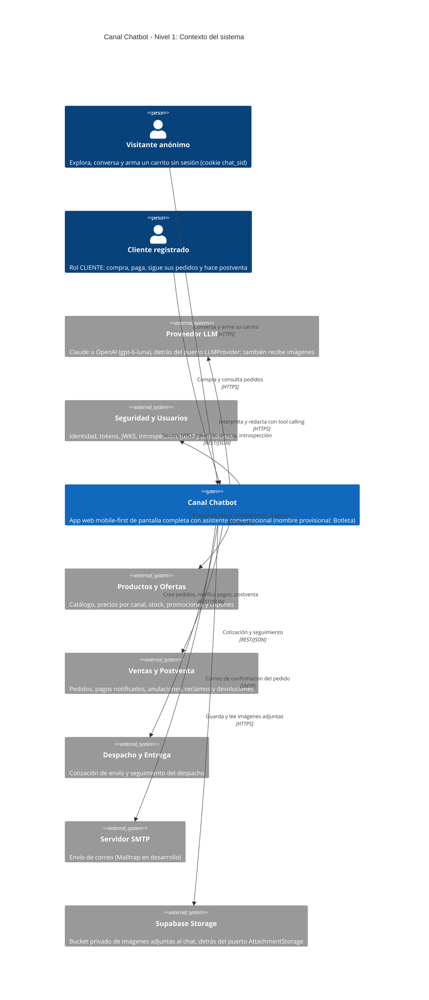
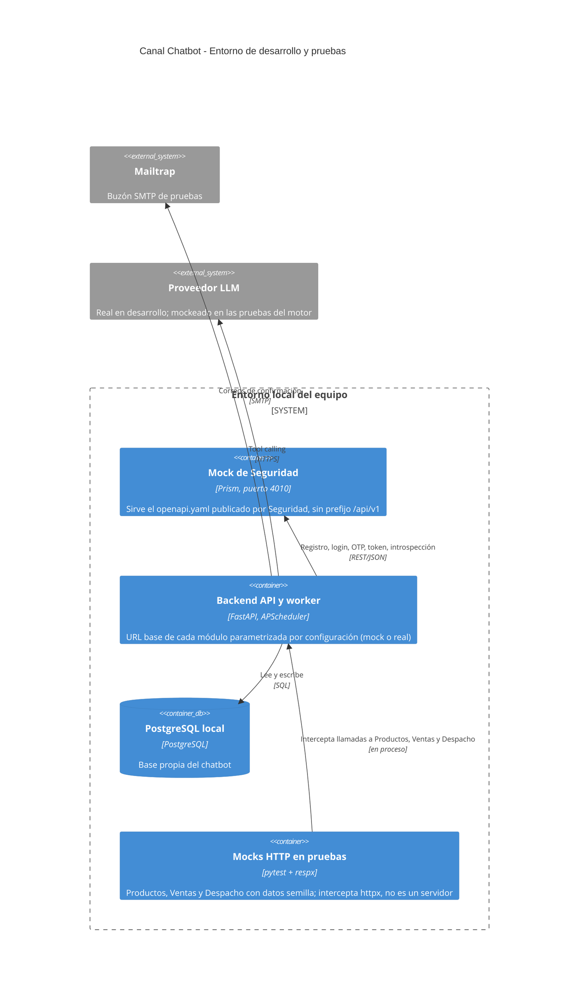
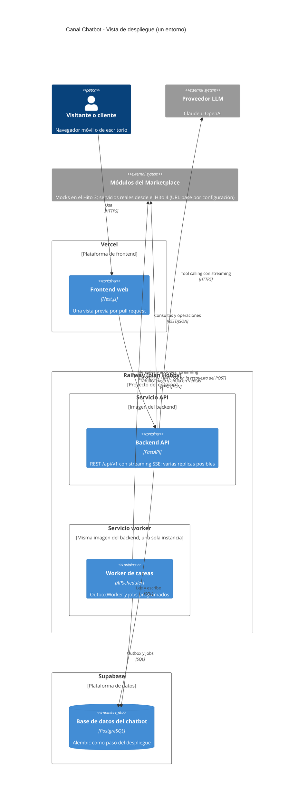
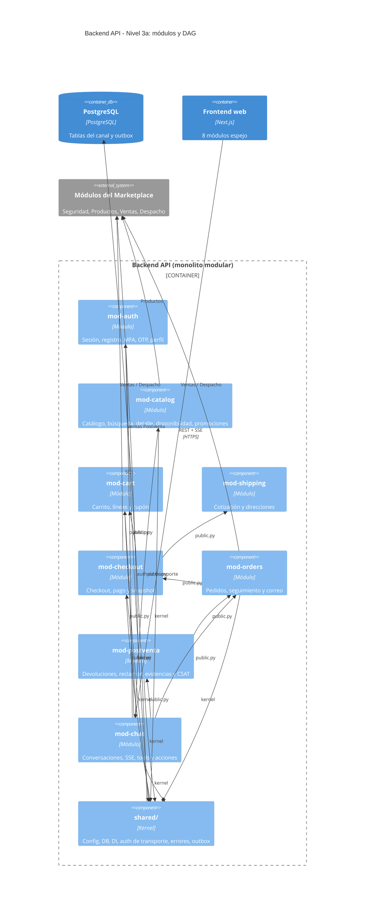
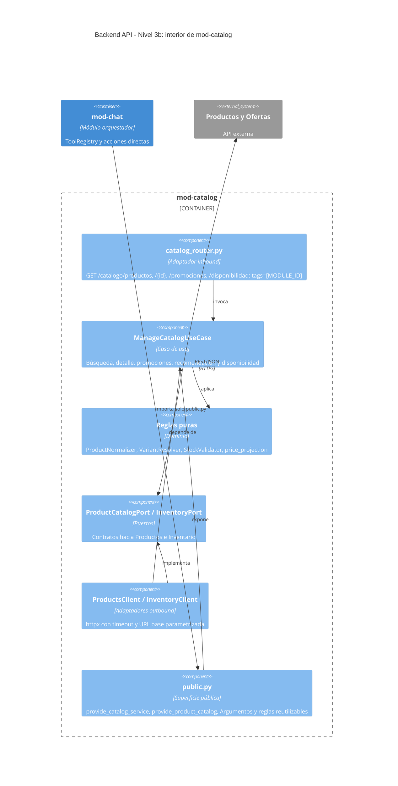

# Modelo C4 — Canal Chatbot

> Vistas de arquitectura del Canal Chatbot según el [modelo C4](https://c4model.com). Todo lo que aparece aquí proviene de [`modularizacion.md`](modularizacion.md), del [ADR-0025](adr/ADR-0025-monolito-modular-por-capacidad.md), de los `design.md` de [`openspec/specs/`](../../openspec/specs/), de [`contratos-integracion.md`](../contratos-integracion.md) y de [`modelo-datos.md`](../modelo-datos.md). Si un diagrama contradice a una spec, manda la spec y este documento se corrige.

**Cómo leer los diagramas**

- Están escritos con la sintaxis C4 de Mermaid (`C4Context`, `C4Container`, `C4Component`), que GitHub renderiza directamente. Esa sintaxis es experimental: el acomodo automático reparte los elementos en filas según el ancho de la pantalla, por lo que en una pantalla angosta algunas flechas pueden cruzar cajas. Las tablas bajo cada diagrama son la referencia exacta.
- Se omite a propósito el **nivel 4 (código)**: la estructura de clases vive en los repositorios `G3-Chatbot-backend` y `G3-Chatbot-frontend`, y la documentarían mejor sus propias herramientas.
- Las decisiones que explican estas vistas están en los [ADR](adr/README.md).

## Contenido

1. [Nivel 1 — Contexto del sistema](#nivel-1--contexto-del-sistema)
2. [Nivel 2 — Contenedores](#nivel-2--contenedores)
3. [Entorno de desarrollo y pruebas](#entorno-de-desarrollo-y-pruebas)
4. [Vista de despliegue](#vista-de-despliegue)
5. [Nivel 3 — Componentes del backend](#nivel-3--componentes-del-backend)
6. [Vista dinámica](#vista-dinámica)
7. [Preguntas abiertas](#preguntas-abiertas)

---

## Nivel 1 — Contexto del sistema

Quién usa el Canal Chatbot y de qué sistemas depende. El canal no es dueño del catálogo, del stock, de los usuarios, de los pedidos ni de los despachos: los consulta por API ([ADR-0013](adr/ADR-0013-solo-referencias-locales-a-agregados-externos.md)).

| Elemento | Tipo | Responsabilidad | Referencia |
|---|---|---|---|
| Visitante anónimo | Persona | Conversa, busca, recibe recomendaciones y arma un carrito anónimo, sin sesión; sus conversaciones se ligan a la cookie `chat_sid` | [`alcance.md` §2](../producto/alcance.md#2-usuarios-y-roles); SPEC-05 a SPEC-11 |
| Cliente registrado | Persona | Token con rol `CLIENTE`: carrito persistente, checkout (con celular verificado), pedidos, reclamos, devoluciones y reembolsos | SPEC-03, SPEC-04 · Req. 1, SPEC-14 · Req. 1 |
| Canal Chatbot | Sistema (en alcance) | Aplicación web propia, mobile-first y de pantalla completa. El asistente se presenta con el nombre de `ASSISTANT_NAME` (provisional: "Botleta") | [README](../../README.md); SPEC-05 · Req. 12 |
| Seguridad y Usuarios | Sistema externo | Registro, login, MFA, refresh, perfil, direcciones, JWKS, token de servicio `client_credentials` e introspección. También envía el correo de verificación de cuenta, cuyo enlace lleva al frontend del chatbot (`canalOrigen: "CHATBOT"`) | [`contratos-integracion.md` §3.1](../contratos-integracion.md#31-seguridad-y-usuarios--base-segapiv1-mock-prism-en-4010-sin-prefijo); A1, A3 |
| Productos y Ofertas | Sistema externo | Catálogo, precios por canal, disponibilidad, promociones, evaluación de cupones y candidatos de recomendación. Rutas aún provisionales (A5) | [`contratos-integracion.md` §3.2](../contratos-integracion.md#32-productos-y-ofertas--base-proapiv1--las-specs-definen-las-capacidades-las-rutas-son-una-propuesta) |
| Ventas y Postventa | Sistema externo | Pedidos (crear, notificar pago, anular, consultar), reclamos y devoluciones con evidencia | [`contratos-integracion.md` §3.3](../contratos-integracion.md#33-ventas-y-postventa--bases-venapiv1-m1--f1-f2-y-venapiv2-m2--f3-f4-f5-f6--contrato-publicado-v130) |
| Despacho y Entrega | Sistema externo | Cotización de envío (`POST /api/v1/cotizaciones`, `destino + lineas`) y seguimiento por pedido (`GET /api/v1/seguimientos/pedidos/{idPedido}`) | [`contratos-integracion.md` §3.4](../contratos-integracion.md#34-despacho-y-entrega--base-desapiv1) |
| Proveedor LLM | Sistema externo | Claude u OpenAI, elegido por configuración, detrás del puerto `LLMProvider`. Con SPEC-23 recibe también imágenes en base64 (modelo `gpt-6-luna`, soporte de visión sin verificar) | SPEC-05 · RNF *Configuración*; [ADR-0005](adr/ADR-0005-llm-con-tool-calling-detras-de-llmprovider.md); [ADR-0019](adr/ADR-0019-imagenes-como-entrada-del-llm.md) |
| Servidor SMTP | Sistema externo | Entrega el correo de confirmación del pedido al cliente (Mailtrap en desarrollo) | SPEC-16 · RNF *Seguridad* |
| Supabase Storage | Sistema externo | Bucket privado previsto para las imágenes que el cliente adjunta al chat (SPEC-23); **pendiente de implementación**. Solo se accederá desde el backend, que emitirá URLs firmadas de corta vida para las miniaturas | SPEC-23; [ADR-0019](adr/ADR-0019-imagenes-como-entrada-del-llm.md) |

Notas:

- **Ventas no recibe las imágenes del chat.** La evidencia de devolución (SPEC-21) se sube a Ventas desde su formulario; las imágenes adjuntas al chat viven solo en el bucket propio del canal.
- **El pago y el SMS no son sistemas externos.** El pago se procesa con un simulador propio detrás de `PaymentGateway` ([ADR-0014](adr/ADR-0014-pago-simulado-detras-de-paymentgateway.md)). El OTP del celular está diseñado para salir por un `SimulatedSmsSender` propio ([ADR-0015](adr/ADR-0015-verificacion-propia-del-celular-por-otp.md)), pero **aún no está implementado**: solo existen la tabla `local_phone_verification` y su adaptador.
- **Marketplace y Retail** son canales hermanos que consumen los mismos módulos; el chatbot no se integra con ellos. La verificación local del celular no se comparte con esos canales (SPEC-04 · *Fuera de alcance*).
- El Gestor de Ventas y el Gestor Comercial de Productos deciden sobre datos que el chatbot muestra (respuestas a reclamos, resoluciones, promociones), pero no usan el canal ([`alcance.md` §2](../producto/alcance.md#2-usuarios-y-roles)).
- Los usuarios con token sin rol `CLIENTE` no pueden comprar: se les cierra la sesión (SPEC-03 · Req. 1).

---

## Nivel 2 — Contenedores

Las unidades ejecutables siguen siendo un frontend Next.js, un backend FastAPI, un worker y PostgreSQL. Lo que cambia respecto de la vista anterior es que **la unidad interna de trabajo es el módulo**: los 8 módulos viven dentro del mismo backend y del mismo frontend, con ids idénticos, y `shared/` es el kernel. Los cuatro módulos del Marketplace se agrupan en una sola caja; el detalle por módulo está en el nivel 1 y en [`modularizacion.md`](modularizacion.md).

```mermaid
C4Container
    title Canal Chatbot - Nivel 2: Contenedores y módulos internos

    System_Ext(smtp, "Servidor SMTP", "Mailtrap en desarrollo")
    System_Ext(mods, "Módulos del Marketplace", "Seguridad, Productos, Ventas y Despacho (detalle en el nivel 1)")
    Person(cliente, "Visitante o cliente", "Navegador móvil o de escritorio")
    System_Ext(llm, "Proveedor LLM", "Claude u OpenAI")
    System_Ext(stor, "Supabase Storage", "Bucket privado de imágenes adjuntas")

    System_Boundary(canal, "Canal Chatbot") {
        Container(fe, "Frontend web", "Next.js 16 App Router, React 19, TypeScript", "8 módulos: mod-auth, mod-catalog, mod-cart, mod-shipping, mod-checkout, mod-orders, mod-postventa, mod-chat; shared/ como kernel")

        Container_Boundary(api, "Backend API — monolito modular (un solo despliegue)") {
            Container(m_auth, "mod-auth", "FastAPI", "Sesión, registro, MFA, OTP, perfil")
            Container(m_catalog, "mod-catalog", "FastAPI", "Catálogo, búsqueda, detalle, disponibilidad, promociones")
            Container(m_cart, "mod-cart", "FastAPI", "Carrito, líneas y cupón")
            Container(m_shipping, "mod-shipping", "FastAPI", "Cotización y direcciones")
            Container(m_checkout, "mod-checkout", "FastAPI", "Checkout, pago y snapshot del pedido")
            Container(m_orders, "mod-orders", "FastAPI", "Pedidos, seguimiento y correo")
            Container(m_postventa, "mod-postventa", "FastAPI", "Devoluciones, reclamos, evidencias y CSAT")
            Container(m_chat, "mod-chat", "FastAPI", "Conversaciones, SSE, tools y acciones directas")
            Container(shared, "shared/ (kernel)", "Python", "Config, DB, DI/capacidades, auth de transporte, errores, outbox, correlación")
        }

        Container(worker, "Worker de tareas", "Python, APScheduler", "OutboxWorker (pago, anulación, correo) y jobs de expiración y limpieza")
        ContainerDb(db, "Base de datos del chatbot", "PostgreSQL, SQLAlchemy 2 + Alembic", "Conversaciones, carrito, checkout, intentos de pago, referencias locales y outbox")
    }

    Rel(cliente, fe, "Usa", "HTTPS")
    Rel(fe, m_chat, "Mensajes y acciones; recibe el streaming", "REST/JSON + JWT; SSE en la respuesta del POST")
    Rel(shared, db, "Lee y escribe", "SQL")
    Rel(worker, db, "Outbox y jobs", "SQL")
    Rel(m_chat, llm, "Tool calling con streaming (texto e imágenes)", "HTTPS")
    Rel(m_chat, stor, "Guarda, lee y firma URLs de imágenes", "HTTPS")
    Rel(m_catalog, mods, "Consultas de catálogo", "REST/JSON")
    Rel(m_checkout, mods, "Ventas y Despacho", "REST/JSON")
    Rel(m_orders, mods, "Ventas y Despacho", "REST/JSON")
    Rel(m_postventa, mods, "Ventas Postventa", "REST/JSON")
    Rel(worker, mods, "Notifica pago y anula en Ventas", "REST/JSON")
    Rel(worker, smtp, "Correo de confirmación", "SMTP")

    Rel(m_chat, m_auth, "public.py", "in-process")
    Rel(m_chat, m_catalog, "public.py", "in-process")
    Rel(m_chat, m_cart, "public.py", "in-process")
    Rel(m_chat, m_checkout, "public.py", "in-process")
    Rel(m_chat, m_orders, "public.py", "in-process")
    Rel(m_chat, m_postventa, "public.py", "in-process")
    Rel(m_checkout, m_cart, "public.py", "in-process")
    Rel(m_checkout, m_shipping, "public.py", "in-process")
    Rel(m_orders, m_checkout, "public.py", "in-process")
    Rel(m_postventa, m_orders, "public.py", "in-process")

    UpdateRelStyle(fe, m_chat, $offsetX="-60", $offsetY="70")
    UpdateLayoutConfig($c4ShapeInRow="5", $c4BoundaryInRow="1")
```

| Elemento | Tipo | Tecnología | Responsabilidad | Referencia |
|---|---|---|---|---|
| Frontend web | Contenedor | Next.js (App Router, solo como frontend) + React + TypeScript, Zustand (`chatStore`), TanStack Query, React Hook Form + Zod, Tailwind CSS | UI de pantalla completa. **8 módulos** (`src/modules/mod-*`) con `ui/`, `application/`, `domain/`, `ports/`, `adapters/` y `public.ts`; `shared/` aloja API, auth, config, DI, seguridad y primitivas. Las rutas de `src/app/**/page.tsx` son wrappers. Adaptador Axios con refresh single-flight y lector `fetch` para SSE. Guarda el `accessToken` en LocalStorage | [`modularizacion.md`](modularizacion.md) §2; [README §1.1, §1.4](../../README.md#11-frontend--nextjs-app-router-hexagonal); `motor-conversacion/design.md` |
| Backend API | Contenedor | Python 3.12, FastAPI, Pydantic v2, SQLAlchemy 2 + Alembic, httpx async, PyJWT (JWKS) | Monolito modular: `src/shared/` + `src/modules/mod_*`. REST en `/api/v1`; el `POST /chat/conversaciones/{id}/mensajes` responde SSE ([ADR-0021](adr/ADR-0021-streaming-por-sse-en-la-respuesta-del-post.md)). `main.py` descubre `module.py` y monta routers; ningún archivo compartido lista módulos. Sin estado en memoria: la conversación vive en PostgreSQL | [`modularizacion.md`](modularizacion.md) §2, §6; [ADR-0025](adr/ADR-0025-monolito-modular-por-capacidad.md); [`contratos-integracion.md` §2](../contratos-integracion.md#2-api-expuesta-por-el-backend-del-chatbot-para-su-frontend) |
| `shared/` (kernel) | Componente interno | Python | Configuración, conexión y modelos de BD, registry de capacidades, `problem+json`, correlation id, auth de transporte (JWKS, service token, `SecurityClient`), rate limit, outbox worker y persistencia compartida. **Sin reglas de negocio y sin imports de módulos** | [`modularizacion.md`](modularizacion.md) §4; `src/shared/README.md` |
| Worker de tareas | Contenedor | Python, APScheduler | `OutboxWorker` (`NOTIFY_SALES_PAYMENT`, `REQUEST_CANCELLATION`, `SEND_EMAIL`, con backoff) y jobs: expiración de checkouts (1 min), limpieza de carritos anónimos (7 días) y de evidencias/adjuntos pendientes (24 h) | [ADR-0011](adr/ADR-0011-outbox-transaccional.md); `grabacion-pedido/design.md`, `checkout-pago/design.md`, `gestion-carrito/design.md`, `solicitud-devolucion-cambio/design.md` |
| Base de datos del chatbot | Contenedor (datos) | PostgreSQL | Tablas propias: `conversation`, `message`, `attachment`, `cart`, `cart_item`, `checkout`, `payment_attempt`, `local_phone_verification`, `order_ref`, `notification`, `claim_ref`, `return_ref`, `evidence`, `outbox` | [`modelo-datos.md`](../modelo-datos.md) |
| Supabase Storage | Sistema externo (almacenamiento) | Bucket privado de Supabase Storage | Destino previsto de las imágenes del chat (SPEC-23): el backend lee los bytes y emite URLs firmadas de corta vida; la tabla `attachment` solo guarda claves. **Pendiente de implementación** | SPEC-23; [ADR-0019](adr/ADR-0019-imagenes-como-entrada-del-llm.md) |

**Protocolos**

| Origen → destino | Protocolo | Uso |
|---|---|---|
| Frontend → Backend API | HTTPS REST/JSON, `Authorization: Bearer <accessToken>`; errores `application/problem+json` con `code` | Crear, listar y buscar conversaciones, enviar mensajes (la respuesta del asistente llega en el stream de la misma respuesta) y ejecutar acciones con efecto |
| Backend API → Frontend | SSE (`Content-Type: text/event-stream`) en la respuesta `200` de `POST /api/v1/chat/conversaciones/{id}/mensajes` | Eventos `aceptado`, `token`, `bloque`, `degradado`, `fin` y `error`. Los errores de validación y pertenencia se responden antes del stream como `application/problem+json`. Si el stream termina sin `fin` ni `error`, el frontend reconsulta una sola vez `GET /chat/conversaciones/{id}/mensajes` (sin `desde`); si no aparece la respuesta, ofrece "Reintentar" |
| Backend API / Worker → módulos | HTTPS REST/JSON con httpx | Token del cliente reenviado cuando el recurso es del titular; token de servicio `modulo-chatbot` para operaciones a nombre del sistema ([ADR-0009](adr/ADR-0009-token-de-servicio-con-servicetokenprovider.md)) |
| Backend API → Proveedor LLM | HTTPS (API del proveedor) | Tool calling con streaming; timeout de 15 s. Con SPEC-23, el contexto puede incluir imágenes en base64 |
| Backend API → Supabase Storage | HTTPS (API de Storage) | Guardar y leer imágenes adjuntas, emitir URLs firmadas y eliminar archivos huérfanos |
| Worker → SMTP | SMTP | Correo de confirmación del pedido |

> **Topología del worker decidida.** El worker corre como servicio propio y en una única instancia, nunca dentro del proceso de la API, para que varias réplicas de la API no ejecuten los jobs más de una vez. Decisión provisional del 2026-10-10: [ADR-0020](adr/ADR-0020-despliegue-en-railway-vercel-y-supabase.md); ver la [vista de despliegue](#vista-de-despliegue).

---

## Entorno de desarrollo y pruebas

Aplica al entorno local y a las pruebas automatizadas; la topología desplegada está en la [vista de despliegue](#vista-de-despliegue), donde el Hito 3 también usa mocks. Explica cómo se integra el backend antes de contar con las APIs reales ([ADR-0017](adr/ADR-0017-mocks-y-urls-base-parametrizadas.md)).

| Elemento | Tipo | Responsabilidad | Referencia |
|---|---|---|---|
| Mock de Seguridad | Servidor mock (Prism, `:4010`) | Sirve el `openapi.yaml` de Seguridad sin el prefijo `/api/v1`; admite ejemplos por cabecera `Prefer` (`code=401`, `example=conMfa`…). Se usa con `client_secret=secreto-de-prueba` hasta el Hito 4 | [`contratos-integracion.md` §3.1](../contratos-integracion.md#31-seguridad-y-usuarios--base-segapiv1-mock-prism-en-4010-sin-prefijo); `inicio-sesion/design.md`; SPEC-14 · RNF |
| Mocks HTTP en pruebas | Biblioteca (pytest + respx) | Intercepta en el mismo proceso las llamadas httpx a Productos, Ventas y Despacho con datos semilla. No es un servidor | [`definicion-listo-terminado.md`](../producto/definicion-listo-terminado.md) R3, D2.1; `busqueda-filtrado/design.md` |
| Mailtrap | Servicio externo de pruebas | Buzón SMTP donde se revisa la plantilla del correo | SPEC-16 · RNF; `notificacion-confirmacion/design.md` |
| URL base parametrizada | Configuración | Cada cliente de módulo toma su URL base de la configuración, para apuntar al mock o al servicio real sin cambiar código | `registro-cliente/design.md` (`SeguridadClient`) |

El proveedor LLM y el stream SSE se mockean en las pruebas del motor de conversación (`motor-conversacion/design.md`, desglose `[QA]`).

---

## Vista de despliegue

Dónde corre cada contenedor del [nivel 2](#nivel-2--contenedores). Decisión **provisional** del 2026-10-10 ([ADR-0020](adr/ADR-0020-despliegue-en-railway-vercel-y-supabase.md)). El diagrama muestra un entorno; *staging* (rama `development`) y producción (rama `main`) repiten la misma topología con secretos propios.

| Nodo | Contenido | Entornos y configuración | Referencia |
|---|---|---|---|
| Vercel | Frontend web (Next.js), con una vista previa por pull request | `development` → *staging*, `main` → producción | [ADR-0023](adr/ADR-0023-proxy-del-frontend-hacia-la-api-mismo-origen.md); [ADR-0020](adr/ADR-0020-despliegue-en-railway-vercel-y-supabase.md); [ADR-0004](adr/ADR-0004-backend-como-bff-y-nextjs-solo-frontend.md) |
| Railway · servicio API | Backend API (REST y respuestas SSE de larga duración). Sin estado en memoria, por lo que admite varias réplicas | Migraciones de Alembic como paso del despliegue; secretos por entorno (LLM, Supabase, URLs base de los mocks) | [ADR-0020](adr/ADR-0020-despliegue-en-railway-vercel-y-supabase.md); [ADR-0021](adr/ADR-0021-streaming-por-sse-en-la-respuesta-del-post.md) |
| Railway · servicio worker | `OutboxWorker` y jobs de APScheduler. **Una sola instancia, fuera del proceso de la API**, para no duplicar jobs | Construido desde la misma imagen del backend que la API | [ADR-0020](adr/ADR-0020-despliegue-en-railway-vercel-y-supabase.md); [ADR-0011](adr/ADR-0011-outbox-transaccional.md) |
| Supabase | PostgreSQL del chatbot (y el bucket de adjuntos descrito en el nivel 2) | Base ya en uso | [`modelo-datos.md`](../modelo-datos.md); [ADR-0019](adr/ADR-0019-imagenes-como-entrada-del-llm.md) |
| Módulos del Marketplace | Mocks en el Hito 3 ([ADR-0017](adr/ADR-0017-mocks-y-urls-base-parametrizadas.md)) y adaptadores falsos en proceso en los entornos desplegados ([ADR-0022](adr/ADR-0022-modulos-simulados-en-proceso-para-los-entornos-desplegados.md)); servicios reales desde el Hito 4 | URL base de cada módulo por configuración del entorno | [ADR-0017](adr/ADR-0017-mocks-y-urls-base-parametrizadas.md) |

Notas:

- El pipeline de CD que despliega estas piezas es la tarea H3-18 y no se describe aquí.
- El envío de correo (SMTP) y el almacenamiento de adjuntos siguen el [nivel 2](#nivel-2--contenedores); no se repiten en esta vista.

---

## Nivel 3 — Componentes del backend

El backend es un **monolito modular**: la unidad de frontera es el módulo, y dentro de cada módulo se conserva el corte hexagonal de ADR-0002 (adaptadores inbound → casos de uso → dominio → puertos outbound). Para que la vista sea legible se divide en cuatro vistas:

- **3a — Módulos y dependencias:** los 8 módulos y el DAG que verifica el manifiesto.
- **3b — Interior de un módulo:** el patrón que repite cada módulo (ejemplo con `mod-catalog`).
- **3c — Superficie pública:** qué expone cada `public.py` y qué capacidades sustituyen imports prohibidos.
- **3d — Módulos del frontend:** las rutas y los adapters de cada `mod-*`.

> La agrupación histórica en 8 casos de uso (ADR-0018) queda **reemplazada en la práctica** por los 8 módulos de ADR-0025. Los nombres de servicios y adaptadores salen de los `MODULE.md` y de los `design.md`.

### 3a — Módulos y dependencias

| Módulo | Caso de uso / entrada | Adaptadores propios | Referencia |
|---|---|---|---|
| `mod-auth` | `ManageSessionUseCase` (login, MFA, refresh, logout, perfil, registro, verificación) | `session_router`, `CustomerPostgresAdapter`, `SecurityClient` (en `shared`) | SPEC-01..04; `mod_auth/MODULE.md` |
| `mod-catalog` | `ManageCatalogUseCase` (búsqueda, detalle, promociones, recomendación, disponibilidad) | `catalog_router`, `ProductsClient`, `InventoryClient`, seeds | SPEC-06..10; `mod_catalog/MODULE.md` |
| `mod-cart` | `ManageCartUseCase` (agregar, cambiar, quitar, vaciar, cupón) | `cart_router`, `CartPostgresAdapter`, `CartItemPostgresAdapter` | SPEC-10, 11, 13; `mod_cart/MODULE.md` |
| `mod-shipping` | `ManageShippingUseCase` (cotización y direcciones) | `shipping_router`, `DespachoClient` | SPEC-12; `mod_shipping/MODULE.md` |
| `mod-checkout` | `ManageCheckoutUseCase` (precondiciones, revalidación, pago, snapshot) | `checkout_router`, `CheckoutPostgresAdapter`, `PaymentAttemptPostgresAdapter`, `PaymentSimulator` | SPEC-12, 14, 15; `mod_checkout/MODULE.md` |
| `mod-orders` | `OrdersService`, `NotificationService` | `orders_router`, `VentasClient`, `EmailSender` | SPEC-15..18; `mod_orders/MODULE.md` |
| `mod-postventa` | `PostventaService` | `claims_router`, `returns_router`, `csat_router`, `PostventaClient` | SPEC-19..22, 24; `mod_postventa/MODULE.md` |
| `mod-chat` | `ManageConversationUseCase`, `InterpretAndRespondUseCase`, `DispatchDirectActionUseCase` | `chatbot_router`, `sse`, `OpenAILLMProvider`, `RegistryToolAdapter` | SPEC-05, 23; `mod_chat/MODULE.md` |

### 3b — Interior de un módulo (patrón común)

Todos los módulos repiten la misma forma. El ejemplo es `mod-catalog`; `mod-cart`, `mod-checkout`,
`mod-orders` y `mod-postventa` cambian los nombres, no la estructura.

| Capa interna | Sí | No |
|---|---|---|
| `adapters/http` | Validar DTOs, aplicar dependencias, llamar a un caso de uso, mapear `code` a HTTP | Lógica de negocio, httpx, SQL |
| `application` | Orquestar puertos, ordenar precondiciones, controlar la transacción | Importar FastAPI, httpx o SQLAlchemy; leer `os.environ` |
| `domain` | Reglas puras y testeables sin I/O | Cualquier import de framework o red |
| `ports` | Interfaces mínimas que el caso necesita | Implementaciones |
| `adapters` (outbound) | Único lugar con httpx/SQL/SMTP/LLM; timeouts propios; normalizar `codigo` → `code` | Decidir reglas de negocio |
| `public.py` | Reexportar lo que otro módulo puede usar | Exponer `domain/`, `application/` o `adapters/` ajenos |
| `module.py` | `MODULE_ID`, `build_router(options)`, `configure(container)` | Lógica de negocio o listas de módulos |

### 3c — Superficie pública por módulo

| Módulo | Superficie pública backend (`public.py`) | Superficie pública frontend (`public.ts`) |
|---|---|---|
| `mod-auth` | `provide_manage_session`, `ManageSessionUseCase`, errores de credenciales/refresh, `merge_cart_lines` | Tipos de sesión y guardas de `/cuenta` |
| `mod-catalog` | `provide_product_catalog`, `provide_product_inventory`, `provide_catalog_service`, `ManageCatalogUseCase`, `SearchArguments`/`ProductArguments`, `VariantResolver`, `normalize_detail`, `sellable_skus`, `price_projection`, `StockValidator` | Tipos de producto, tarjeta y disponibilidad |
| `mod-cart` | `provide_cart_service`, `provide_cart_repositories` (`CartRepositories`), `ManageCartUseCase`, `CartError` | Tipos de carrito e ítem |
| `mod-shipping` | `DispatchPort`, `provide_despacho_client`, `provide_shipping_service`, `build_destination`, `build_quote_lines`, `parse_quote` | Tipos de cotización y dirección |
| `mod-checkout` | `provide_checkout_service`, `provide_sales_port`, `provide_outbox_processor`, `ManageCheckoutUseCase`, `PaymentGatewayPort` | Tipos de checkout, pago y resultado |
| `mod-orders` | `OrdersService`, `provide_orders_service`, `NotificationService`/`NotificationError`, `map_order_status_label`, `sanitize_tracking_payload` | Tipos de pedido, seguimiento e hitos |
| `mod-postventa` | `PostventaService`, `provide_postventa_service`, `PostventaPort`, los DTO de detalle | Tipos de devolución, reclamo y CSAT |
| `mod-chat` | `provide_chatbot_service`, `provide_turn_scope`, `provide_action_scope`, `provide_tool_registry`, `InterpretAndRespondUseCase`, `DispatchDirectActionUseCase`, `QUICK_ACTIONS` | Tipos de evento SSE, mensaje y bloque |

**Capacidades que sustituyen imports prohibidos:** `cart_repositories`, `checkout_document`,
`dispatch_port`, `order_confirmation`, `outbox_processor` y `action_scope`. Las registra el módulo
dueño en `configure()` y las resuelve el consumidor en tiempo de request. El detalle está en
[`modularizacion.md`](modularizacion.md) §3.

### 3d — Módulos del frontend

| Módulo | Rutas Next | Componentes clave | Endpoints que usa |
|---|---|---|---|
| `mod-auth` | `/cuenta`, `/verificar-correo` | `AuthModal`, `LoginForm`, `RegistroForm`, `OtpMfaForm`, `OtpCelularForm`, `MiCuentaPage` | `/sesion/*`, `/contacto/celular/verificar-otp` **(sin backend)** |
| `mod-catalog` | `/` | `HomePage`, `ProductCard`, `CarruselProductos`, `DetalleProducto`, `SelectorVariante` | `/catalogo/productos`, `/catalogo/productos/{id}`, `/catalogo/disponibilidad` |
| `mod-cart` | `/carrito` | `CartPage`, `BloqueCarrito`, `CartDiscounts` | `/carrito`, `/carrito/items`, `/carrito/cupon` |
| `mod-shipping` | bloque en `/checkout` | `CotizacionEnvio` | `/envio/cotizar`, `/direcciones` |
| `mod-checkout` | `/checkout`, `/exito` | `CheckoutPage`, `DireccionForm`, `PagoForm`, `OrderSuccessPage` | `/checkout`, `/checkout/{id}`, `/checkout/{id}/pago` |
| `mod-orders` | `/pedidos`, `/pedidos/[tab]`, `/seguimiento` | `OrderHistoryPage`, `ListaPedidos`, `EstadoPedido`, `DeliveryRating` | `/pedidos`, `/pedidos/{id}`, `/pedidos/{id}/seguimiento`, `/pedidos/{id}/csat`, `/pedidos/{id}/reenviar-confirmacion` |
| `mod-postventa` | `/devolucion`, `/reclamo` | `DevolucionPage`, `ReclamoPage`, `ConstanciaDevolucion`, `ConstanciaReclamo` | `/devoluciones`, `/reclamos`, `/evidencias` |
| `mod-chat` | `/chat/[id]`, `/sugerencias` | `ChatPage`, `ChatWindow`, `MessageBubble`, `SugerenciasPage` | `/chat/conversaciones`, `/chat/conversaciones/{id}/mensajes` |

Notas:

- Las rutas de `src/app/**/page.tsx` no son la unidad de cambio: son wrappers de una línea que
  montan `AppShell` + `AuthGuard` + la página del módulo.
- `mod-auth` declara `/contacto/celular/verificar-otp` en su manifiesto y su adapter, pero el backend
  no lo expone. Es el hueco de contrato más visible de la auditoría 2026-11.
- `mod-chat` declara `/sugerencias` como ruta, pero el formulario aún no llama a un endpoint; el
  backend no tiene `POST /sugerencias`.
- No hay un endpoint interno `/admin/outbox-fallidos`: esa vista era una propuesta de fase 0 y no se
  implementó.

---

## Vista dinámica

No se repite aquí: la secuencia de un turno de texto (REST → `InterpretarYResponderUseCase` → `SensitiveDataFilter` → `LLMProvider` → `ToolRegistry` → módulo → SSE) está en [`flujos-conversacion.md` (e)](../conversacion/flujos-conversacion.md#e-secuencia-de-un-turno-de-texto), y el flujo de checkout y pago en [`flujos-conversacion.md` (c)](../conversacion/flujos-conversacion.md#c-checkout-y-pago).

---

## Preguntas abiertas

> La topología del worker y el despliegue quedaron resueltos, de forma provisional, por el [ADR-0020](adr/ADR-0020-despliegue-en-railway-vercel-y-supabase.md).

1. **Contrato OpenAPI ↔ frontend.** El manifiesto del frontend declara endpoints, pero ningún gate los compara con `docs/openapi.json`. El test manual ya incluye `POST /contacto/celular/verificar-otp`, que el backend no expone. ¿Se implementa el script de contrato o se retira el endpoint del manifiesto mientras SPEC-04 no exista?
2. **SPEC-04 y SPEC-23.** La tabla `local_phone_verification` y el modelo `attachment` existen, pero faltan OTP, `CheckoutGuard`, endpoints de adjuntos y `AttachmentStorage`. ¿Entran en el próximo hito o se retiran del contrato?
3. **`shared/` y el worker.** El worker de outbox vive en `shared/`; si crece con jobs de un módulo concreto, hay que decidir si se mueve al módulo dueño o se queda como kernel.
