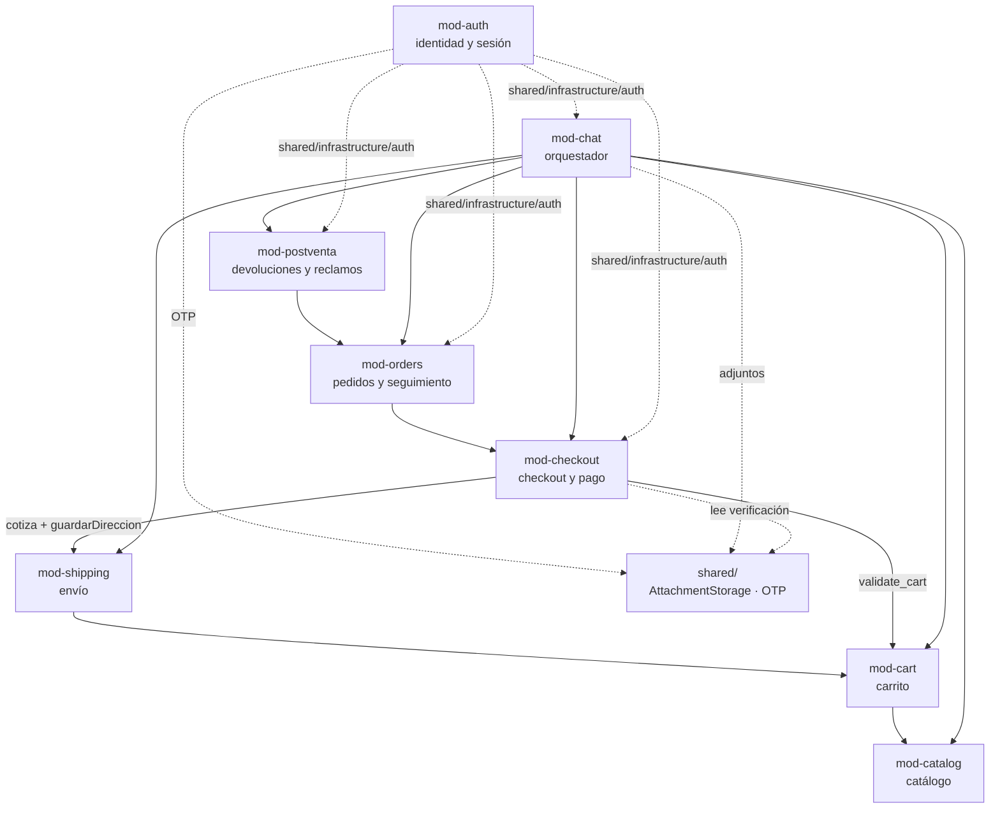

# Monolito modular por capacidad

> **Decisión:** [ADR-0025](adr/ADR-0025-monolito-modular-por-capacidad.md), que homologa el
> [ADR-0024 del backend](../../../G3-Chatbot-backend/docs/adr/ADR-0024-modularizacion.md).
> **Fuente operativa:** [`modules.manifest.json` del backend](../../../G3-Chatbot-backend/modules.manifest.json)
> y [`modules.manifest.json` del frontend](../../../G3-Chatbot-frontend/modules.manifest.json).
> También en GitHub: [ADR-0024 del backend](https://github.com/Taller-SW-Web/G3-Chatbot-backend/blob/development/docs/adr/ADR-0024-modularizacion.md)
> y [manifiesto del backend](https://github.com/Taller-SW-Web/G3-Chatbot-backend/blob/development/modules.manifest.json).
> Si este documento contradice una spec, manda la spec; si contradice el manifiesto, manda el manifiesto.

## 1. Qué cambió y qué no

El canal sigue siendo **un backend FastAPI y un frontend Next.js**, con Clean Architecture + Hexagonal
dentro de cada pieza. Lo que cambió es el **corte primario**: ya no se agrupa el código por capa
(`domain/`, `application/`, `ports/`, `adapters/` en la raíz), sino por **capacidad de negocio**.

- Backend: `src/shared/` (kernel) + `src/modules/mod_<id>/` (8 módulos) + `src/infrastructure/`
  (composition root: `main.py` y `discovery.py`).
- Frontend: `src/shared/` (kernel) + `src/modules/mod-<id>/` (8 módulos) + `src/app/**/page.tsx`
  (wrappers de ruta que componen la página del módulo).
- Los ids son **idénticos en ambos repos**: `mod-auth`, `mod-catalog`, `mod-cart`, `mod-shipping`,
  `mod-checkout`, `mod-orders`, `mod-postventa`, `mod-chat`.
- No cambian las URLs públicas, el contrato REST/SSE ni el despliegue. Tampoco se introducen
  microservicios ni repositorios nuevos.

Dentro de cada módulo se conserva la regla de dependencia de ADR-0002:
`adapters → application → domain`, con `ports` como contratos. La diferencia es que ahora la frontera
entre capacidades también es una regla verificable.

## 2. Los 8 módulos

| id | Capacidad | Backend (`src/modules/…`) | Rutas públicas | Frontend | Owner |
|---|---|---|---|---|---|
| `mod-auth` | Sesión, registro, MFA, OTP, perfil, verificación de correo | `mod_auth` — `/sesion` | `/sesion/login`, `/mfa/*`, `/refresh`, `/logout`, `/perfil`, `/registro`, `/politica-contrasena`, `/verificar-correo*`, `/contacto/celular/solicitar-otp`, `/contacto/celular/verificar-otp` | `/cuenta`, `/verificar-correo` | @Taller-SW-Web/chatbot |
| `mod-catalog` | Catálogo, búsqueda, detalle, disponibilidad, promociones, recomendación | `mod_catalog` — `/catalogo` | `/catalogo/productos`, `/productos/{id}`, `/promociones`, `/disponibilidad` | `/` (home, tarjetas, detalle) | @Taller-SW-Web/chatbot |
| `mod-cart` | Carrito, líneas, cupón y totales | `mod_cart` — `/carrito` | `GET/POST/PATCH/DELETE /carrito*`, `/carrito/cupon` | `/carrito` | @Taller-SW-Web/chatbot |
| `mod-shipping` | Cotización de envío y direcciones guardadas | `mod_shipping` — `/direcciones`, `/envio` | `GET /direcciones`, `POST /envio/cotizar` | bloque de envío en `/checkout` | @Taller-SW-Web/chatbot |
| `mod-checkout` | Checkout, pago simulado, snapshot del pedido y outbox | `mod_checkout` — `/checkout` | `POST /checkout`, `GET /checkout/{id}`, `POST /checkout/{id}/pago` | `/checkout`, `/exito` | @Taller-SW-Web/chatbot |
| `mod-orders` | Pedidos, detalle, seguimiento y reenvío de confirmación | `mod_orders` — `/pedidos` | `GET /pedidos`, `/{id}`, `/{id}/seguimiento`, `POST /{id}/reenviar-confirmacion` | `/pedidos`, `/pedidos/[tab]`, `/seguimiento` | @Taller-SW-Web/chatbot |
| `mod-postventa` | Devoluciones, reclamos, evidencias y CSAT | `mod_postventa` — `/devoluciones`, `/reclamos`, `/evidencias`, `/pedidos/{id}/csat` | `POST/GET /devoluciones*`, `POST/GET /reclamos*`, `POST /evidencias`, `POST /pedidos/{id}/csat` | `/devolucion`, `/reclamo` | @Taller-SW-Web/chatbot |
| `mod-chat` | Conversaciones, historial, SSE, tools, acciones directas, reacciones, sugerencias y adjuntos | `mod_chat` — `/chat/conversaciones`, `/mensajes/{id}/reaccion`, `/sugerencias` | `POST/GET /chat/conversaciones`, `/buscar`, `/{id}/mensajes` (SSE en el `POST`), `POST /mensajes/{id}/reaccion`, `POST /sugerencias`, `/chat/adjuntos/{id}` | `/chat/[id]`, `/sugerencias` | @Taller-SW-Web/chatbot |

Cada módulo backend contiene:

```text
src/modules/mod_<id>/
├── MODULE.md          # responsabilidad, rutas, superficie pública y reglas
├── __init__.py        # MODULE_ID canónico
├── module.py          # MODULE_ID, build_router(options), configure(container)
├── public.py          # única superficie que otros módulos pueden importar
├── domain/            # reglas puras
├── application/       # casos de uso, DTOs, orquestación
├── ports/             # contratos propios
└── adapters/          # HTTP, persistencia, clientes externos
```

Cada módulo frontend contiene `MODULE.md`, `module.manifest.ts`, `public.ts`, `ports/`, `adapters/`,
`application/`, `domain/` y `ui/`. El manifiesto declara `id`, `name`, `owner`, `routes`, `nav`,
`endpoints` y `dependsOn`.

## 3. DAG de dependencias

El grafo es **dirigido y acíclico**. Se declara en `dependsOn` del manifiesto y se verifica contra los
imports reales. Todas las flechas van del **consumidor al proveedor**: `A --> B` significa que `A` declara a `B` en su `dependsOn` y puede importar su `public.py`. Es la misma convención de la tabla "Nuevos usos entre módulos" y del manifiesto (`cart` depende de `catalog`, `shipping` de `cart`, `checkout` de `cart` y `shipping`, `orders` de `checkout`, `postventa` de `orders`).



Reglas:

1. `mod-chat` es la cima: puede depender de todos; **ningún módulo depende de `mod-chat`**.
2. `mod-auth` no es una dependencia directa de los módulos de comercio: el contrato de Seguridad
   (JWKS, `ServiceTokenProvider`, `SecurityClient`) vive en `shared/infrastructure/auth` para que
   cualquier módulo autentique al titular sin importar `mod_auth`. Por eso el diagrama dibuja `auth`
   como dependencia transversal (línea punteada) y no como una flecha directa de `chat → auth`; el
   manifiesto conserva `mod-auth` en `dependsOn` de `chat` como permiso, aunque hoy no se importe.
3. `mod-shipping` **depende de `mod-cart`**: lo declara en `dependsOn` y consume
   `provide_cart_repositories` desde `mod_cart.public`. Ya no existe la capacidad
   `cart_repositories` resuelta en runtime.
4. `mod-orders` depende de `mod-checkout` (`orders --> checkout`), así que `mod-checkout` no puede
   importar a `mod-orders` (sería un ciclo). Cuando checkout necesita encolar la confirmación de correo
   que posee orders, la resuelve por la capacidad `order_confirmation`.
5. `mod-orders` necesita el puerto de Despacho: lo resuelve por `dispatch_port`, registrado por
   `mod-shipping`.
6. `mod-cart` y `mod-catalog` necesitan la memoria de conversación que posee `mod-chat`; como el DAG
   no permite que comercio importe al orquestador, la consumen por la capacidad
   `conversation_context`.
7. Cuando el DAG prohíbe un import directo, la respuesta no es importar el interior: es una
   **capacidad** registrada en `src/shared/infrastructure/di/capabilities.py`.

Capacidades vigentes:

| Capacidad | La registra | La consume | Motivo |
|---|---|---|---|
| `conversation_context` | `mod-chat` | `mod-cart`, `mod-catalog` | memoria de conversación sin que comercio importe al orquestador |
| `checkout_document` | `mod-checkout` | `mod-auth` | `ultimoDocumento` del perfil sin acoplar auth a checkout |
| `dispatch_port` | `mod-shipping` | `mod-orders` | seguimiento sin depender de shipping |
| `order_confirmation` | `mod-orders` | `mod-checkout` | encolar el correo de confirmación |
| `outbox_processor` | `mod-checkout` | worker de `shared/` | el lifespan no importa módulos |
| `action_scope` | `mod-chat` | composition root | acciones directas con su propia sesión de BD |

### Nuevos usos entre módulos (decisiones 2026-11-21)

Las decisiones D1–D7 no añaden módulos ni cambian el DAG; amplían superficies públicas ya permitidas y el kernel compartido. No se crean capacidades nuevas en `capabilities.py` para estos usos.

| Consumidor | Proveedor | Superficie | Decisión |
|---|---|---|---|
| `mod-checkout` | `mod-cart` | `ManageCartUseCase.validate_cart` vía `mod_cart.public` (validación masiva con detalle por línea) | D3 · stock |
| `mod-checkout` | `mod-shipping` | `GuardarDireccionOpcional` en `mod_shipping.public` (nueva función; el guardado en Seguridad no bloquea el checkout) | D6 · dirección |
| `mod-chat` | `shared/` | Puerto `AttachmentStorage` con adaptadores `local` (desarrollo) y `supabase` (implementado en `development`, que es la rama de producción; faltan bucket y variables, fail-closed ya implementado en backend #198), según `ATTACHMENT_STORAGE` | D2 · adjuntos |
| `mod-chat` | `shared/` | Tablas `message_reaction` y `feedback_suggestion`; `AttachmentStorage` para la captura de un bug | D5 · feedback |
| `mod-checkout` | `shared/` | Tabla `purchase_rating` para la valoración de la experiencia de compra | D5 · feedback |
| `mod-postventa` | `shared/` | `order_ref.csat_sent` y outbox para la notificación interna de sugerencias | D5 · feedback |
| `mod-auth` | `shared/` | Escritura de `phone_otp_challenge` y `local_phone_verification` | D1 · OTP |
| `mod-checkout` | `shared/` | Lectura de `local_phone_verification` para el `CheckoutGuard`; el correo del perfil llega por el adaptador de Seguridad, no por `mod-auth` | D1 · D2 · OTP |

Regla: si el código prefiere resolver alguno de estos usos por una capacidad en vez de por `public.py`, se registra en `src/shared/infrastructure/di/capabilities.py` y se actualiza esta tabla; el DAG no cambia.

**Validación al arranque.** `discovery.configure_modules` llama a `configure()` de cada módulo y
después valida las capacidades declaradas en `REQUIRED_CAPABILITIES`: si falta una requerida, aborta el
arranque indicando el módulo dueño. Las de `OPTIONAL_CAPABILITIES` que faltan se registran con
`logger.error` y quedan en el registry; `/health` responde `200` con
`{"status": "degraded", "missingCapabilities": [...]}` en lugar de `{"status": "ok"}`. Hoy
`conversation_context` es requerida por `mod-cart` y `mod-catalog`; `order_confirmation` por
`mod-checkout`; `dispatch_port` por `mod-orders`; `checkout_document` es opcional para `mod-auth`.

## 4. `shared/` es el kernel, no un cajón

`shared/` no contiene reglas de negocio ni conoce a los módulos. En backend aloja:

- `config/` — settings por entorno (12-factor).
- `db/` — conexión, modelos y migraciones Alembic; incluye las tablas compartidas
  (`conversation`, `message`, `attachment`, `local_phone_verification`, `outbox`, `order_ref`, etc.).
- `di/` — registry de capacidades y contenedor.
- `http/` — `problem+json`, correlation id, auth de transporte, rate limit, health, clientes base.
- `auth/` — JWKS, `ServiceTokenProvider` y `SecurityClient`.
- `persistence/` — adaptadores compartidos (conversación, mensaje, adjunto, outbox, verificación local).
- `worker/` — outbox worker y jobs.
- `domain/` — `CallerIdentity`, errores de módulo, masking, filtro de datos sensibles y entidades de
  conversación/mensaje que comparten catálogo, carrito y chat.

En frontend aloja `api/` (Axios + refresh single-flight), `auth/` (sesión y `chatStore`), `commerce/`,
`config/` (`apiConfig`, contrato de manifiesto), `di/`, `security/` (CSP y sanitize), `testing/` y
`ui/` (iconos, shell, primitivas). **No hay reglas de negocio en `shared/`.**

## 5. Contrato backend ↔ frontend

El contrato tiene cuatro piezas y una convención:

1. **Tags OpenAPI.** Cada `APIRouter` declara `tags=[MODULE_ID]`; el backend publica
   `docs/openapi.json` con un tag `mod-*` por operación. Es la vista canónica de las rutas.
2. **Manifiestos.** `modules.manifest.json` define ids, owners y `dependsOn`. El manifiesto de cada
   módulo frontend declara las rutas Next (`routes`), la navegación (`nav`) y los endpoints que usa
   (`endpoints`); `scripts/sync-modules.mjs` genera `src/modules/registry.generated.ts`.
3. **Superficie pública.** En backend, `public.py` es lo único importable por otro módulo. En frontend,
   `public.ts` expone tipos y guardas; `shared/` y `app/` solo pueden importar `public.ts`.
4. **Capacidades.** Sustituyen imports prohibidos por el DAG, como se describe en §3.
5. **Convención HTTP.** JSON `camelCase`, enums `UPPER_SNAKE_CASE`, fechas ISO 8601 UTC, moneda PEN con
   2 decimales, errores `application/problem+json` con `code` estable y `Idempotency-Key` en toda
   operación que crea algo o mueve dinero. El frontend ramifica por `code`, nunca por el texto.

El frontend habla con `/api/v1` a través del proxy del mismo origen (ADR-0023); el backend es el único
que conoce las URLs de Seguridad, Productos, Ventas y Despacho, y los tokens de servicio nunca llegan
al navegador.

### Estado real del gate de contrato

| Verificación | Dónde | Qué cubre | Estado |
|---|---|---|---|
| Estructura, fronteras y tags | `G3-Chatbot-backend/scripts/check_modules.py` | ids, `MODULE.md`, `public.py`, imports, tags `mod-*`, composition root | Bloqueante en CI |
| Manifiestos y fronteras | `G3-Chatbot-frontend/scripts/check-modules.mjs` | paridad de ids, estructura, `dependsOn`, registry generado, imports profundos | Bloqueante en CI |
| OpenAPI del backend | `G3-Chatbot-backend/scripts/export_openapi.py` + job `openapi` | que `docs/openapi.json` se genere desde la app, sea válido y coincida con el archivo comprometido | Generación, validación y check de drift bloqueantes en CI (BE #165, mergeado) |
| Endpoints del manifiesto contra OpenAPI | `G3-Chatbot-frontend/scripts/check-modules.mjs` + job `modules` | que cada `endpoint` del frontend exista y tenga el tag del módulo | **Bloqueante en CI**: `modules` es requerido por `check`; allowlist CSAT con `reviewBy` 2026-12-19 |

## 6. Auto-discovery: nadie edita una lista compartida

**Backend.** `src/infrastructure/discovery.py` recorre `src/modules/*/module.py` con `pkgutil`, los
ordena por nombre (OpenAPI estable) y llama a `configure(container)`. `main.py` monta cada
`build_router(options)` bajo `/api/v1`. Añadir un módulo no edita `main.py`.

**Frontend.** Cada módulo declara `module.manifest.ts`; `pnpm modules:sync` regenera
`src/modules/registry.generated.ts`. `pnpm modules:check` falla si el registry está desactualizado.
Las rutas de `src/app/**/page.tsx` son wrappers: componen `AppShell` + `AuthGuard` + la página del
módulo, sin lógica de negocio.

**Migraciones.** Hay una cadena única de Alembic. El nombre de cada revisión sigue
`YYYYMMDD_mod_<id>_<desc>`; una rama de migraciones por módulo queda como opción futura.

## 7. Reglas de trabajo (norma, no sugerencia)

1. **Se lee la spec del módulo antes de tocar código.** `openspec/specs/<capability>/spec.md` para el
   comportamiento y `design.md` para el contrato. Si la spec no existe o está desactualizada, se
   corrige primero.
2. **Si el código avanza sin estar en la spec, la spec se actualiza en el mismo PR.** Es un *spec
   delta* obligatorio: no se deja para un PR posterior.
3. **Revisión de coherencia.** Antes de mergear, se compara lo nuevo con lo que ya existía: no se
   contradicen specs previas, estados ya cerrados ni decisiones de ADR. Si hay conflicto, se marca la
   decisión y se actualiza el ADR o la spec; no se silencia.
4. **Un PR/MR por módulo.** El PR declara el `mod-*` que toca y no modifica archivos de otro módulo.
   `shared/` solo entra con la etiqueta `cross-modulo` y revisión del owner de plataforma.
5. **Contrato antes que UI.** Un endpoint nuevo va primero al `design.md` y al OpenAPI; el adapter del
   frontend y su manifiesto se actualizan en el mismo cambio.
6. **Tests y gates.** Backend: `pytest`, `ruff`, `mypy`, `python scripts/check_modules.py`. Frontend:
   `pnpm lint`, `pnpm typecheck`, `pnpm test`, `pnpm modules:check`. El merge exige el CI en verde.

## 8. Cómo añadir una capacidad o un endpoint

1. Localiza el módulo dueño en la tabla de §2. Si la capacidad es nueva, crea el módulo en **ambos**
   manifiestos y en **ambas** carpetas; no inventes un id distinto.
2. Escribe o actualiza la spec (`spec.md`) y el `design.md` con la ruta, el payload, los estados y los
   errores.
3. Backend: DTO en `adapters/http`, caso de uso en `application/`, regla pura en `domain/`, puerto si
   hace falta, y `build_router`/`configure` en `module.py`. Declara `tags=[MODULE_ID]`.
4. Frontend: puerto en `ports/`, adapter en `adapters/`, caso de uso en `application/`, UI en `ui/` y
   el endpoint en `module.manifest.ts`.
5. Añade tests unitarios, de integración y, si toca contrato, el caso en
   `tests/unit/shared/api-rutas-contrato.test.ts`.
6. Ejecuta `python scripts/export_openapi.py` (backend) y `pnpm modules:sync` (frontend).
7. Actualiza `MODULE.md` y, si cambia el DAG, el manifiesto y este documento.
8. Abre un PR por módulo con la checklist de [`docs/flujo-de-trabajo.md`](../flujo-de-trabajo.md).

## 9. Deuda y huecos conocidos

- **Verificación cruzada de OpenAPI.** El gate de contrato (H-04) es bloqueante: el job `modules` del
  frontend descarga `docs/openapi.json` de `development`, ejecuta `pnpm modules:check` y `check` lo
  exige en la rama protegida. Falla si un endpoint del manifiesto no existe o si el tag no coincide; la
  única excepción es CSAT (`/pedidos/{pedidoId}/csat`, tag `mod-postventa`), registrada en
  `scripts/module-boundaries.exceptions.json` con `reviewBy` 2026-12-19. El backend genera, valida y
  verifica el drift del OpenAPI en CI: el job `openapi` incluye
  `Verify committed OpenAPI is up to date` (`python scripts/export_openapi.py --check`, 47 paths), mergeado
  en [BE #165](https://github.com/Taller-SW-Web/G3-Chatbot-backend/pull/165), así que un archivo
  comprometido desactualizado rompe el pipeline.
- **SPEC-04 (validación de celular).** ✅ Implementado el 2026-11-21 (D1): `phone_otp_challenge`,
  endpoints de OTP, `SimulatedSmsSender`, `CheckoutGuard` real y `REQUIRE_PHONE_VERIFICATION` están en
  `development` (backend #141 · `b75fbea6`, frontend #109 · `7432d463`). **D2 (2026-11-25):** el guard
  pasa a contacto verificado con `REQUIRE_VERIFIED_CONTACT` (correo del perfil por defecto o celular
  verificado localmente) y `REQUIRE_PHONE_VERIFICATION` queda como modo legado; el OTP sigue disponible
  de forma opcional desde "Mi cuenta".
- **SPEC-23 (adjuntos).** 🟡 El flujo de adjuntos está implementado en `development` el 2026-11-21 (D2): `attachment`, endpoints de carga, borrado y URL firmada, EXIF/miniaturas, limpieza y `adjuntoIds`. El adaptador `SupabaseAttachmentStorage` y el selector `ATTACHMENT_STORAGE=local|supabase` entraron después en `development` (backend #144 · `e4faadf`), y producción ejecuta `development` desde el 2026-11-26 (`main` es un placeholder). Faltan el bucket privado y las variables de storage ([specs#53](https://github.com/Taller-SW-Web/G3-Chatbot-specs/issues/53)); el fail-closed de `local` en producción ya está implementado en backend #198. Producción conserva `ATTACHMENT_STORAGE=local` sobre un volumen efímero hasta configurar Supabase (ADR-0028, [runbook](../operacion/adjuntos-supabase.md)).
- **SPEC-24 (retroalimentación).** ✅ Implementado el 2026-11-21 (D5): reacciones, sugerencias/bugs,
  CSAT, valoración de compra y outbox interno están mergeados; la UI dejó de ser estado local.
- **Cupones, stock y direcciones.** ✅ Implementado (D3 y D6): el checkout invoca `validate_cart` y
  propaga `guardarDireccion`; un fallo de Seguridad no bloquea.
- **Orden de búsqueda (SPEC-06).** ✅ Implementado (D7): el router valida el enum `relevancia |
  precio_asc | precio_desc | nombre_asc | nombre_desc` y aplica el orden.

Quedan como mejoras posteriores, fuera de las 24 capabilities: la deuda de nombres históricos (S4) y
la ampliación de tools conversacionales (M5). El gate de contrato bloqueante (S2) y el gate de drift
OpenAPI (L4) quedaron cerrados el 2026-11-25 ([BE #165](https://github.com/Taller-SW-Web/G3-Chatbot-backend/pull/165)).
El detalle y la evidencia están en [`docs/auditoria-specs-2026-11.md`](../auditoria-specs-2026-11.md).

## 10. Mapa de las 24 specs a módulos

| Spec | Capacidad | Módulo(s) |
|---|---|---|
| SPEC-01 | `registro-cliente` | `mod-auth` |
| SPEC-02 | `verificacion-correo` | `mod-auth` |
| SPEC-03 | `inicio-sesion` | `mod-auth` (+ `mod-cart` en la fusión) |
| SPEC-04 | `validacion-celular` | `mod-auth` + `mod-checkout` (guard) |
| SPEC-05 | `motor-conversacion` | `mod-chat` |
| SPEC-06 | `busqueda-filtrado` | `mod-catalog` |
| SPEC-07 | `recomendacion` | `mod-catalog` |
| SPEC-08 | `ofertas-promociones` | `mod-catalog` |
| SPEC-09 | `tarjetas-detalle-producto` | `mod-catalog` |
| SPEC-10 | `validacion-stock` | `mod-catalog` + `mod-cart` + `mod-checkout` |
| SPEC-11 | `gestion-carrito` | `mod-cart` |
| SPEC-12 | `direccion-cotizacion-envio` | `mod-shipping` + `mod-checkout` |
| SPEC-13 | `cupones` | `mod-cart` + `mod-checkout` |
| SPEC-14 | `checkout-pago` | `mod-checkout` |
| SPEC-15 | `grabacion-pedido` | `mod-checkout` + `mod-orders` |
| SPEC-16 | `notificacion-confirmacion` | `mod-orders` |
| SPEC-17 | `consulta-estado-pedido` | `mod-orders` |
| SPEC-18 | `seguimiento-despacho` | `mod-orders` + `mod-shipping` |
| SPEC-19 | `creacion-reclamo` | `mod-postventa` |
| SPEC-20 | `consulta-reclamo` | `mod-postventa` |
| SPEC-21 | `solicitud-devolucion-cambio` | `mod-postventa` |
| SPEC-22 | `consulta-devolucion-reembolso` | `mod-postventa` |
| SPEC-23 | `adjuntos-imagenes-chat` | `mod-chat` (+ `shared/` storage) |
| SPEC-24 | `retroalimentacion-cliente` | `mod-postventa` (CSAT) + `mod-chat` (reacciones/sugerencias) + `mod-checkout` (valoración) |
