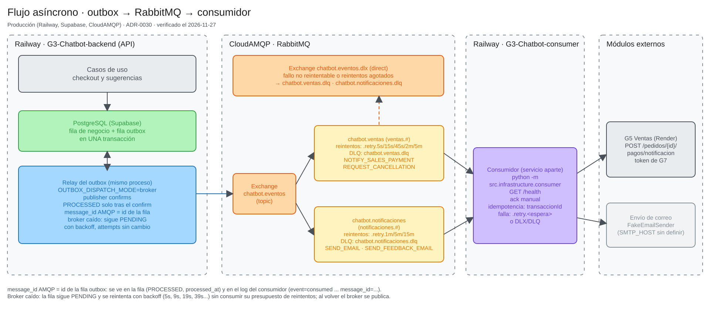

# Evidencia del mecanismo asíncrono

> Tarea H5-M4 de [`odd/tasks/hito-5.md`](../odd/tasks/hito-5.md), issue [#63](https://github.com/Taller-SW-Web/G3-Chatbot-specs/issues/63). Fecha: 2026-11-27 (UTC).
> Decisión de diseño: [ADR-0030](arquitectura/adr/ADR-0030-rabbitmq-como-mecanismo-asincrono-del-outbox.md).

Este documento reúne la evidencia de que las tareas del outbox salen de la API, pasan por RabbitMQ y las consume un proceso aparte, sin perder eventos cuando el broker cae.

## 1. Resumen

| Criterio de aceptación de #63 | Estado | Dónde |
|---|---|---|
| `message_id` visible en publicación y consumo | Cumplido | §3 y §4 |
| Prueba con el broker caído sin pérdida de eventos | Cumplido | §5 |
| Enlaces a workflows, commits y PR | Cumplido | §2 y §4 |

Hallazgo de la prueba: tras reiniciar el broker, el consumidor no volvía a consumir mientras `/health` decía `ok`. La corrección está en el PR [#215](https://github.com/Taller-SW-Web/G3-Chatbot-backend/pull/215), todavía abierto. Producción la recibe después del merge y del redespliegue del consumidor (§5.3).

## 2. Arquitectura y código



Fuente editable: [`diagrams/flujo-asincrono-outbox.excalidraw`](diagrams/flujo-asincrono-outbox.excalidraw).

Los casos de uso de checkout y sugerencias escriben la fila de negocio y la fila del outbox en una sola transacción. El relay vive en el proceso de la API, publica con confirmación del broker y marca la fila `PROCESSED` solo después del confirm. El consumidor es un servicio aparte, con `ack` manual.

| Pieza | Referencia |
|---|---|
| Relay del outbox | PR [#196](https://github.com/Taller-SW-Web/G3-Chatbot-backend/pull/196), squash `bd57e30`, issue [#176](https://github.com/Taller-SW-Web/G3-Chatbot-backend/issues/176) |
| Consumidor | PR [#197](https://github.com/Taller-SW-Web/G3-Chatbot-backend/pull/197), `cd1e13d`, issues [#177](https://github.com/Taller-SW-Web/G3-Chatbot-backend/issues/177) y [#168](https://github.com/Taller-SW-Web/G3-Chatbot-backend/issues/168) (H5-P5) |
| Reconexión del consumidor | PR [#215](https://github.com/Taller-SW-Web/G3-Chatbot-backend/pull/215), commit `d5a08f4` (abierto, pendiente de revisión al escribir este documento) |
| Topología y rutas | `src/shared/infrastructure/broker/topology.py` y `declare.py` del backend |

Topología declarada en el código:

| Elemento | Nombre |
|---|---|
| Exchange de eventos | `chatbot.eventos` (topic) |
| Exchange de fallos | `chatbot.eventos.dlx` (direct) |
| Cola de Ventas | `chatbot.ventas`, binding `ventas.#`, reintentos `.retry.5s`, `.15s`, `.45s`, `.2m`, `.5m`, DLQ `chatbot.ventas.dlq` |
| Cola de notificaciones | `chatbot.notificaciones`, binding `notificaciones.#`, reintentos `.retry.1m`, `.5m`, `.15m`, DLQ `chatbot.notificaciones.dlq` |

| Tipo de outbox | Clave de enrutamiento | Cola |
|---|---|---|
| `NOTIFY_SALES_PAYMENT` | `ventas.pago.notificar` | `chatbot.ventas` |
| `REQUEST_CANCELLATION` | `ventas.anulacion.solicitar` | `chatbot.ventas` |
| `SEND_EMAIL` | `notificaciones.correo.confirmacion` | `chatbot.notificaciones` |
| `SEND_FEEDBACK_EMAIL` | `notificaciones.correo.retroalimentacion` | `chatbot.notificaciones` |

El `message_id` AMQP es el `id` de la fila del outbox.

## 3. Producción: pago publicado y consumido en procesos separados

Railway, proyecto `chatbot`, entorno `production`.

| Servicio | Configuración |
|---|---|
| `G3-Chatbot-backend` | API con `OUTBOX_DISPATCH_MODE=broker` |
| `G3-Chatbot-consumer` | Misma imagen, inicio `python -m src.infrastructure.consumer`, healthcheck `/health`, reinicio `ON_FAILURE` hasta 5 veces |

El broker es CloudAMQP, plan gratuito.

### 3.1 Pago de punta a punta (2026-11-27)

Checkout desde la web con el usuario autenticado. Pedido `PED-2026-00094`, checkout `e37f6e0e-0ccd-4479-a87b-f582175a3eac`, total S/ 189.90. Respuestas: `POST /api/v1/checkout` 201 y `POST /api/v1/checkout/e37f6e0e-.../pago` 200.

| Hora (UTC) | Evento |
|---|---|
| 00:49:52.43 | La transacción crea dos filas del outbox: `4928f3be-dc95-7e3a-b055-9f21d6a2e9e3` (`NOTIFY_SALES_PAYMENT`, `transaccionId` `SIM-4f29151e-8e56-4168-aafd-f7ff7ac2caa4`, monto 189.9 PEN) y `1a802328-f7ff-76c1-83a4-64691ce4a2c4` (`SEND_EMAIL`) |
| 00:49:58.70 | La fila `SEND_EMAIL` queda `PROCESSED` |
| 00:50:01.66 | El relay publica `NOTIFY_SALES_PAYMENT`: fila `PROCESSED`, `attempts` 0 |
| 00:50:04.744 | El consumidor registra `event=consumed` |

Log del consumidor, textual:

```text
2026-11-27 00:50:02,192 INFO httpx HTTP Request: POST https://g7-auth-service.onrender.com/api/v1/auth/token "HTTP/1.1 200 OK"
2026-11-27 00:50:03,635 INFO httpx HTTP Request: POST https://g5-servicio-ventas.onrender.com/api/v1/pedidos/PED-2026-00094/pagos/notificacion "HTTP/1.1 200 OK"
2026-11-27 00:50:04,744 INFO src.shared.infrastructure.broker.consumer event=consumed queue=chatbot.ventas type=NOTIFY_SALES_PAYMENT message_id=4928f3be-dc95-7e3a-b055-9f21d6a2e9e3 attempt=1
```

El `message_id` del consumo (`4928f3be-...`) coincide con el `id` de la fila del outbox. La API no registra la publicación en el log: la evidencia del lado de publicación es la fila (`id` igual a `message_id`, estado `PROCESSED`, `processed_at`).

### 3.2 Evento de retroalimentación (2026-11-26)

Sugerencia desde `/sugerencias`: `POST /api/v1/sugerencias` 201.

| Hora (UTC) | Evento |
|---|---|
| 21:26:10.18 | Fila `8f2108b6-3ca6-7385-a436-6377c581548e` (`SEND_FEEDBACK_EMAIL`) creada |
| 21:26:11.36 | Fila `PROCESSED` |
| 21:26:12.36 | `event=consumed queue=chatbot.notificaciones type=SEND_FEEDBACK_EMAIL message_id=8f2108b6-... attempt=1` |

## 4. CI y rendimiento con broker

| Evidencia | Enlace |
|---|---|
| Prueba de integración publicar → consumir contra RabbitMQ en Docker | `tests/integration/test_outbox_consumer_rabbitmq.py`, job `Migrations and integration tests` de `.github/workflows/ci.yml` (servicio `rabbitmq:4`) |
| CI de `development` en el commit `cd1e13d` (PR #197), en verde | [run 45894049016](https://github.com/Taller-SW-Web/G3-Chatbot-backend/actions/runs/45894049016) |
| Carga con broker (H5-P5) | [run 45887721116](https://github.com/Taller-SW-Web/G3-Chatbot-backend/actions/runs/45887721116), PASS |

En la corrida de carga el consumidor consumió 1533 de 1533 pagos aprobados, con `retried` 0, `deadLettered` 0 y `failed` 0. El detalle está en [`slo-performance.md`](slo-performance.md#4-resultados) (sección 4) y no se repite aquí.

## 5. Prueba con el broker caído

### 5.1 Entorno

Docker local, 2026-11-27 (UTC): `postgres:18` y `rabbitmq:4.1-management`. La API corre en modo `broker`, el consumidor es un proceso aparte, los módulos externos son fakes y `OUTBOX_POLL_INTERVAL_SECONDS=1`. Los logs se conservaron fuera del repositorio; las líneas citadas aquí son textuales. Los logs del consumidor local están en hora local (UTC-5): 19:55:03 equivale a 00:55:03 UTC.

### 5.2 Resultado

| Hora (UTC) | Evento |
|---|---|
| 00:55:03.93 | Pago base `01a21a7f-a8bc-7a84-9747-242686aaefcd`: fila `PROCESSED` |
| 00:55:03.97 | Consumido: `event=consumed queue=chatbot.ventas type=NOTIFY_SALES_PAYMENT message_id=01a21a7f-a8bc-7a84-9747-242686aaefcd attempt=1` |
| 00:55:19 | `docker stop` del broker |
| 00:55:21.11 | Se crea el pago `01a21a7f-ed21-707c-9249-0cc3f7b21f5a`; la fila queda `PENDING` |
| 00:55:21 a 00:56:23 | El relay no recibe confirmación y reprograma la fila (log siguiente) |
| 00:56:23 | `docker start` del broker |
| 00:56:37.64 | La fila pasa a `PROCESSED` con `attempts` 0 |

Log del relay durante la caída, textual:

```text
Broker did not confirm outbox job 01a21a7f-ed21-707c-9249-0cc3f7b21f5a, rescheduled in 5s: publish not confirmed by the broker (ChannelInvalidStateError)
Broker did not confirm outbox job 01a21a7f-ed21-707c-9249-0cc3f7b21f5a, rescheduled in 9s: publish not confirmed by the broker (ChannelInvalidStateError)
Broker did not confirm outbox job 01a21a7f-ed21-707c-9249-0cc3f7b21f5a, rescheduled in 19s: publish not confirmed by the broker (ChannelInvalidStateError)
Broker did not confirm outbox job 01a21a7f-ed21-707c-9249-0cc3f7b21f5a, rescheduled in 39s: publish not confirmed by the broker (ChannelInvalidStateError)
```

Estado final del outbox: `NOTIFY_SALES_PAYMENT` 2 `PROCESSED` y `SEND_EMAIL` 2 `PROCESSED`. Ningún evento se perdió ni se duplicó. Una caída del broker no consume el presupuesto de reintentos de la fila: `attempts` se mantuvo en 0.

### 5.3 Defecto encontrado y corrección

Tras el reinicio del broker, la cola `chatbot.ventas` quedó con 1 mensaje y 0 consumidores, mientras `/health` respondía `ok`. El mensaje se consumió solo al reiniciar el proceso del consumidor (00:58:56 UTC, `attempt=1`, `message_id=01a21a7f-ed21-707c-9249-0cc3f7b21f5a`).

Causa, confirmada en aio-pika 10.2.3: una cola obtenida con `get_queue(ensure=False)` no la rastrea el canal robusto, así que sus consumidores no se restauran tras la reconexión.

Corrección en el PR [#215](https://github.com/Taller-SW-Web/G3-Chatbot-backend/pull/215):

- El consumidor usa `declare_queue`, que el canal robusto sí rastrea.
- `/health` cuenta los consumidores vivos.

Verificación local de la corrección:

| Prueba | Resultado |
|---|---|
| Test de integración que corta la conexión con un proxy TCP (`test_the_consumer_resumes_consuming_after_the_connection_is_lost`) | Falla con el código anterior y pasa con la corrección |
| `docker stop` y `docker start` manuales | `/health` queda `unavailable` durante la caída y vuelve a `ok`; un mensaje publicado después del reinicio se consume sin reiniciar el proceso |

Estado: la corrección no está en producción. Se despliega después del merge del PR #215 y del redespliegue de `G3-Chatbot-consumer`.

## 6. Límites conocidos

- No hay servidor SMTP en producción (`SMTP_HOST` sin definir). `SEND_EMAIL` y `SEND_FEEDBACK_EMAIL` usan `FakeEmailSender`: la tarea se procesa, pero no se entrega ningún correo.
- G5 Ventas (Render) puede responder lento en frío. El 2026-11-26, entre 21:18 y 21:24, el checkout devolvió 503 (unos 31 a 35 s). El 2026-11-27 estaba en caliente y funcionó.
- La API no registra la publicación; la evidencia es la fila del outbox.
- `SEND_FEEDBACK_EMAIL` no tiene deduplicación persistente.
- No existe un `correlation_id` distinto de `message_id`; el `message_id` cumple ese papel en esta evidencia.
- La prueba con el broker caído se hizo en Docker local, no en producción, para no detener el broker compartido: Railway tiene un solo entorno.

## Referencias

- Issue [#63](https://github.com/Taller-SW-Web/G3-Chatbot-specs/issues/63) (H5-M4), backend [#176](https://github.com/Taller-SW-Web/G3-Chatbot-backend/issues/176), [#177](https://github.com/Taller-SW-Web/G3-Chatbot-backend/issues/177), [#168](https://github.com/Taller-SW-Web/G3-Chatbot-backend/issues/168).
- [ADR-0030](arquitectura/adr/ADR-0030-rabbitmq-como-mecanismo-asincrono-del-outbox.md).
- [`slo-performance.md`](slo-performance.md).
