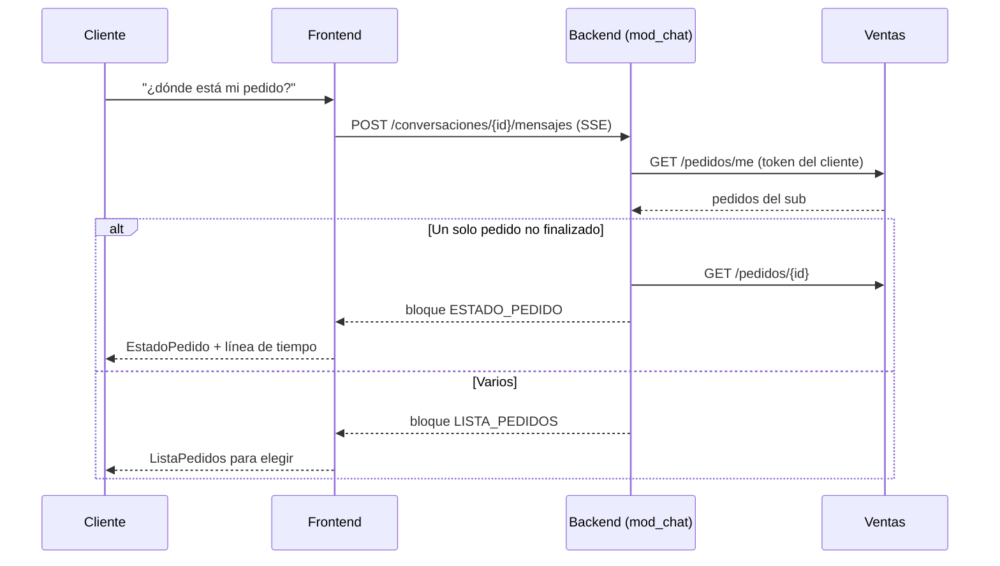
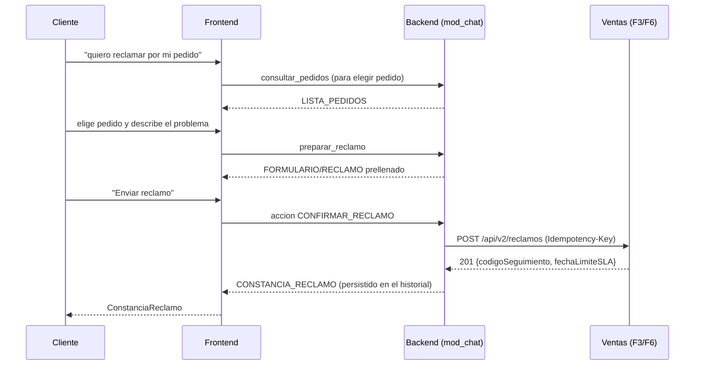
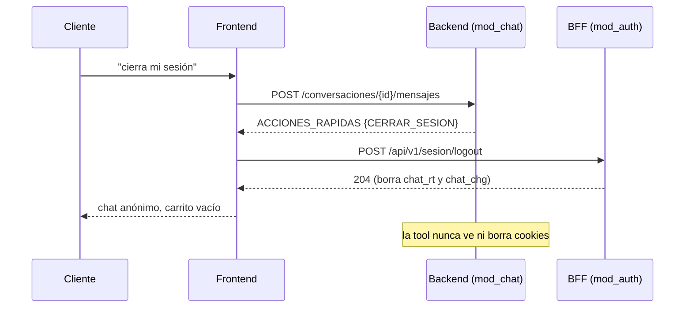

# Diseño: catálogo de herramientas sin ambigüedades (M5)

> Origen: SPEC-05 · Especificación de comportamiento: [`spec.md`](../../specs/motor-conversacion/spec.md) · Delta: [`specs/motor-conversacion/spec.md`](specs/motor-conversacion/spec.md)

## Decisiones

### D1. Se consolida en `consultar_pedidos`; no hay alias

**Decisión:** el catálogo publica una sola herramienta de pedidos, `consultar_pedidos {pedidoId?, estado?}`. `listar_pedidos` y `consultar_pedido` dejan de existir como nombres de herramienta y no se registran como alias.

**Por qué:**

- El backend ya implementa exactamente esa herramienta (`mod_catalog/application/tools.py:183-186`,
  `mod_chat/application/tools/order_handlers.py:125-203`) y `ActionDispatcher` mapea
  `MIS_PEDIDOS`, `CONSULTAR_PEDIDOS` y `VER_PEDIDO` a ella (`action_dispatcher.py:23-25`).
- Un alias duplica la descripción semántica en el prompt: dos herramientas con la misma
  intención compiten y bajan la precisión de tool calling, que SPEC-05 mide con un umbral de
  90 % en CI. Además reabre la pregunta «¿cuál uso?» en cada implementación.
- `pedidoId` es el identificador que el bloque `LISTA_PEDIDOS` ya entrega; no hace falta un
  `pedidoRef` numérico como en productos, porque los pedidos no se muestran en un carrusel.

**Alternativa descartada:** registrar `listar_pedidos` y `consultar_pedido` como alias del
mismo handler. Se descarta porque el contrato del LLM no debe exponer nombres que la spec ya
no reconoce y porque los alias no resuelven la ambigüedad de argumentos (`soloEnCurso` vs
`pedidoRef`).

**Impacto:** es un cambio **BREAKING de la spec**, no del código. No se renombra ningún handler
ni endpoint. `docs/conversacion/intenciones.md` y los diagramas se actualizan a
`consultar_pedidos`.

### D2. `silenciar_complementos` entra al catálogo

**Decisión:** se documenta como herramienta de primera clase: sin argumentos, sin sesión, sin
confirmación, sin bloques. Su efecto es `contexto.crossSellSilenciado = true` y
`crossSellPending = false` en la memoria de la conversación.

**Evidencia:** `mod_catalog/application/tools.py:160` (registro), `discovery.py:267-272`
(efecto y texto), `interpret_and_respond_use_case.py:276-277` (se fuerza cuando el cliente
responde "no, gracias" a un complemento pendiente). SPEC-07 · Requisito 3 ya describe el
efecto; faltaba el nombre de la herramienta en SPEC-05.

### D3. Las listas de reclamos y devoluciones usan bloques propios

**Decisión:** se completan `LISTA_RECLAMOS` y `LISTA_DEVOLUCIONES` en `Bloque.tipo` (19 tipos). Los
detalles usan `ESTADO_RECLAMO` y `ESTADO_DEVOLUCION`; las constancias,
`CONSTANCIA_RECLAMO` y `CONSTANCIA_DEVOLUCION`.

**Por qué:**

- SPEC-20 · Requisito 1 exige mostrar código, fecha, pedido, motivo y estado «para elegir»; un
  texto con chips no puede mostrar esas cinco columnas sin inventar un formato.
- SPEC-22 · Requisito 1 exige código, pedido, fecha, motivo resumido, `estadoReembolso` y badge
  de estado. Es la misma necesidad.
- Los componentes `ListaReclamos` y `ListaDevoluciones` ya existen y están exportados por
  `mod-postventa/public.ts`; el frontend incluso declara ambos tipos en `BloqueTipo.ts:20-25`
  con un TODO. Lo que falta es el enum del backend (`shared/domain/block.py`) y la lista de
  `docs/contratos-integracion.md` §2.1, que este delta completa.

**Alternativa descartada:** reutilizar `ACCIONES_RAPIDAS` con un chip por caso. Se descarta
porque pierde los datos que la spec obliga a mostrar y porque obliga a un turno extra por cada
reclamo o devolución.

### D4. Cuatro acciones de cliente, no cuatro herramientas de servidor

**Decisión:** `iniciar_checkout`, `cerrar_sesion`, `nueva_conversacion` y
`buscar_conversaciones` devuelven `ACCIONES_RAPIDAS` con `IR_A_CHECKOUT`, `CERRAR_SESION`,
`NUEVO_CHAT` y `BUSCAR_CHATS`. El frontend las intercepta antes de enviarlas al BFF; si llegan
al BFF, responden `ACCION_DESCONOCIDA`.

**Por qué:** el backend no puede navegar, no puede crear una conversación «desde el hilo
actual» sin cerrar el turno y no puede borrar cookies `httpOnly`. Convertir estos efectos en
herramientas de servidor obliga a inventar endpoints o a simular el efecto. El patrón de
acción directa ya existe (`ActionDispatcher`, `POST /mensajes` con `accion`) y el frontend ya
navega desde un bloque (`BloquesContenedores.tsx:20-34` lleva al checkout desde el carrito).

**Regla de ejecución:** si el cliente pidió la acción por texto, el frontend la ejecuta en ese
turno una sola vez; al rehidratar el historial no se reejecuta. Es el mismo criterio de
idempotencia que ya usa el cierre de sesión desde `AccountPage`.

### D5. `iniciar_checkout` solo señala la salida

**Decisión:** la herramienta no crea el checkout, no cotiza, no pide dirección y no devuelve
`RESUMEN_CHECKOUT`. Devuelve `IR_A_CHECKOUT`; `CheckoutPage` resuelve dirección, cotización y,
con el botón "Confirmar y pagar", el `POST /checkout` real (SPEC-14 · Requisitos 1 y 2).

**Por qué:** SPEC-12 · RNF prohíbe enviar la dirección al LLM y SPEC-14 · Requisito 1 dice que
dirección y cotización se resuelven en `CheckoutPage`. La redacción anterior («lleva a
`CheckoutPage` con la sección de dirección enfocada») era correcta en intención pero no decía
quién navega ni qué devuelve la herramienta.

**Aclaración sobre `RESUMEN_CHECKOUT`:** el bloque existe y el renderer lo pinta, pero ninguna
herramienta lo produce hoy. Se reserva para el resumen que arma `CheckoutPage` una vez que el
checkout existe; no es la respuesta de `iniciar_checkout`.

### D6. `cerrar_sesion` no toca cookies

**Decisión:** la herramienta devuelve `CERRAR_SESION`. El frontend ejecuta el mismo camino que
`AccountPage`: `POST /api/v1/sesion/logout` (el BFF rota y borra `chat_rt` y `chat_chg`), luego
`chatStore.logout()` descarta el access token de LocalStorage. La herramienta no recibe ni
manipula cookies.

**Evidencia:** `mod-auth/adapters/authApi.ts:70-76` (logout + limpieza del store),
`SesionIndicator.tsx:28` (mismo camino desde la UI), SPEC-03 · Requisito 6 (el BFF llama a
`POST /auth/logout` y borra la cookie).

**Por qué:** una tool que corre en el servidor no puede borrar una cookie del navegador; el
refresh token vive en `httpOnly` y solo el BFF puede invalidarlo. Simular el logout en el
backend dejaría la cookie viva y daría una falsa sensación de cierre.

### D7. La regla del pedido único se aplica solo a pedidos no finalizados

**Decisión:** `consultar_pedidos` sin `pedidoId` ni `estado` muestra `ESTADO_PEDIDO` solo si hay
**exactamente un pedido no finalizado** (`CREADO`, `PAGADO`, `EN_PREPARACION`, `DESPACHADO`).
Si no hay ninguno en curso, devuelve `LISTA_PEDIDOS` aunque haya un solo pedido entregado o
anulado. Con `estado` explícito siempre devuelve lista.

**Por qué:** SPEC-17 · Requisito 1 dice «si tiene un solo pedido no finalizado lo muestra
directamente». El handler actual (`order_handlers.py:142-171`) decide con el total de pedidos
(`len(items) == 1 and not args.estado`), así que con un único pedido `ENTREGADO` muestra el
detalle en lugar del historial. Es una desalineación real que este delta cierra; se marca como
tarea de backend, no como comportamiento ya correcto.

### D8. Las constancias las produce la acción de confirmación

**Decisión:** el envío del formulario es una acción directa `CONFIRMAR_RECLAMO` o
`CONFIRMAR_DEVOLUCION` (botón "Enviar reclamo"/"Enviar solicitud"). El backend registra en
Ventas con idempotencia, persiste el mensaje y responde con `CONSTANCIA_RECLAMO` o
`CONSTANCIA_DEVOLUCION`. `preparar_reclamo` y `preparar_devolucion` solo devuelven el
formulario.

**Por qué:** las constancias deben quedar en el historial de la conversación; un mensaje
construido solo en el navegador desaparece al recargar. Es el mismo patrón de las acciones
directas de SPEC-05 · Requisito 8 (`AGREGAR_AL_CARRITO` responde con el bloque `CARRITO`).

**Datos:** el bloque reutiliza exclusivamente campos que Ventas ya devuelve en el `201`
(SPEC-19 · Requisito 2 y SPEC-21 · Requisito 4). No se agregan campos ni endpoints de Ventas.

### D9. La brecha del renderer es una tarea, no un hecho consumado

**Decisión:** la spec exige renderizar los ocho bloques de pedidos y postventa; el estado
actual del frontend se documenta en `tasks.md` como pendiente. Ningún escenario del delta
declara que el renderer ya funciona.

**Evidencia de la brecha:**

- `MessageBubble.tsx:108-214` solo cubre `ACCIONES_RAPIDAS`, `LISTA_PROMOCIONES`,
  `DETALLE_PRODUCTO`, `RESUMEN_CHECKOUT`, `CARRUSEL_PRODUCTOS`, `CARRITO`,
  `SELECTOR_VARIANTE`, `FORMULARIO` y `CONFIRMACION_PEDIDO`; el `default` descarta el resto.
- `BloqueTipo.ts:15-25` declara los tipos (con TODO en `LISTA_RECLAMOS` y
  `LISTA_DEVOLUCIONES`), pero no hay unión discriminada ni renderer para ellos.
- `ListaPedidos.tsx:3-7` espera `{id, direccion, fecha}` y el backend envía
  `{pedidoId, fecha, total, estado, estadoEtiqueta, canal}`.
- `ListaReclamos.tsx:5-9` espera `{codigo, estado, motivo, plazo}`; `ConstanciaReclamo.tsx:5`
  solo recibe `codigo`; `ConstanciaDevolucion.tsx` y `EstadoDevolucion.tsx` solo reciben
  `codigo` y `estado`. Son prototipos de wireframe, no el contrato de `datos`.
- `mod-orders/public.ts` y `mod-postventa/public.ts` ya exportan los componentes, y
  `mod-chat/module.manifest.ts:22-30` ya declara la dependencia con `mod-postventa`; falta el
  cableado, no la frontera.
- La misma brecha afecta a `FORMULARIO/LOGIN` y `FORMULARIO/REENVIO_VERIFICACION`:
  `MessageBubble` solo pinta `OTP_CELULAR` y `REGISTRO` (`esFormularioRegistro` exige
  `formulario === "REGISTRO"`). Se resuelve en el mismo PR de renderer.

## Flujo de consulta de pedidos

## Flujo de postventa

## Flujo de acciones de cliente

## Estado del catálogo: implementado vs. pendiente

| Herramienta | Estado hoy | Fuente |
|---|---|---|
| `buscar_productos`, `ver_detalle_producto`, `consultar_disponibilidad`, `consultar_promociones`, `recomendar_productos`, `silenciar_complementos` | Implementadas | `mod_catalog/application/tools.py` |
| `agregar_al_carrito`, `ver_carrito`, `cambiar_cantidad`, `quitar_del_carrito`, `vaciar_carrito` | Implementadas | `mod_chat/application/tools/cart_handlers.py` |
| `consultar_pedidos` | Implementada | `mod_chat/application/tools/order_handlers.py` |
| `solicitar_registro`, `verificar_celular` | Implementadas | `mod_catalog/application/tools.py`, `phone_handlers.py` |
| `consultar_seguimiento` | Contrato en `ToolContract`, sin handler de chat | `shared/application/tools/tool_contracts.py` |
| `preparar_reclamo`, `listar_reclamos`, `consultar_reclamo`, `preparar_devolucion`, `listar_devoluciones`, `consultar_devolucion` | Sin herramienta de chat (solo endpoints REST de `mod_postventa`) | `tool_contracts.py` no las lista |
| `aplicar_cupon`, `quitar_cupon` | Sin herramienta de chat (solo `POST/DELETE /carrito/cupon`) | `tool_contracts.py` no las lista |
| `solicitar_login`, `reenviar_verificacion`, `iniciar_checkout` | Contrato en `ToolContract`, sin handler | `tool_contracts.py` |
| `cerrar_sesion`, `nueva_conversacion`, `buscar_conversaciones` | Contrato en `ToolContract`, sin handler; pasan a ser acciones de cliente | `tool_contracts.py` |

## Revisión de coherencia

> [!warning] Nombres retirados en documentos históricos
> `docs/producto/historias/EP-07-seguimiento.md` y `docs/casos-prueba-hito-3.md` mencionan
> `listar_pedidos` y `consultar_pedido` como registro de la planeación y de una corrida de
> pruebas del Hito 3. No se reescriben: son evidencia fechada. La fuente vigente es este delta y
> `docs/conversacion/intenciones.md`.

> [!note] Auditoría 2026-11
> `docs/auditoria-specs-2026-11.md:53` marca SPEC-05 como «✅ Al día» citando
> `mod_catalog/application/tools.py:183-219`. Esa foto verifica que las herramientas existen,
> pero no compara sus nombres con la spec; por eso no detectó el drift `consultar_pedidos` vs
> `listar_pedidos`/`consultar_pedido`. La auditoría se conserva como registro; este cambio deja
> el catálogo alineado y las tareas de implementación abiertas.

> [!note] Sin contradicción con SPEC-17 ni con la ruta de detalle
> `consulta-estado-pedido/design.md` se actualiza a `consultar_pedidos {pedidoId?, estado?}`. Los
> bloques, los estados y la ruta `/pedido?pedidoId=` no cambian. La regla del pedido único se
> alinea con el texto ya vigente de SPEC-17 · Requisito 1 (D7).

> [!note] Sin contradicción con SPEC-03
> El cierre de sesión sigue ocurriendo por `POST /api/v1/sesion/logout`, que el BFF traduce a
> `POST /auth/logout` y borra la cookie. Lo único que cambia es que la tool ya no promete hacerlo
> por sí misma: devuelve la acción y el frontend ejecuta el mismo camino que `AccountPage`.

> [!note] Sin contradicción con SPEC-14
> `iniciar_checkout` sigue sin pagar y sin crear el checkout. `POST /checkout` y
> `POST /checkout/{id}/pago` no cambian; el pago continúa ocurriendo solo en `CheckoutPage`.

> [!note] Sin cambios de datos
> No hay migraciones ni tablas nuevas. `claim_ref` y `return_ref` conservan sus columnas; el
> `codigoSeguimiento` y el `devolucionId` se muestran tal como los devuelve Ventas.

## Archivos que este cambio alinea

| Archivo | Cambio |
|---|---|
| `openspec/changes/2026-11-25-catalogo-tools-motor-conversacion/specs/motor-conversacion/spec.md` | Delta: 3 requisitos modificados y 3 agregados |
| `docs/conversacion/intenciones.md` | Nombres canónicos, `silenciar_complementos`, acciones de cliente |
| `docs/conversacion/flujos-conversacion.md` | Diagrama de pedidos a `consultar_pedidos` |
| `docs/conversacion/dialogos-ejemplo.md` | Dos llamadas de herramienta renombradas |
| `docs/conversacion/kpis.md` | Métrica de postventa con el nombre canónico |
| `docs/contratos-integracion.md` | §2.1: dos bloques nuevos y acciones de cliente |
| `openspec/specs/consulta-estado-pedido/design.md` | Herramienta consolidada |
| `openspec/specs/inicio-sesion/design.md` | `cerrar_sesion` como acción de cliente |
| `openspec/specs/checkout-pago/design.md` | `iniciar_checkout` como acción `IR_A_CHECKOUT` |
| `docs/producto/historias/EP-02-conversacion.md` | Trazabilidad del escenario «Desde una tarjeta de pedido» |

> [!important] La spec base no se toca en este PR
> `openspec/specs/motor-conversacion/spec.md` conserva la tabla anterior hasta que el cambio se
> aplique y se archive. Mientras el cambio esté activo, este delta es la fuente de verdad del
> catálogo; `intenciones.md` lo indica en su encabezado.
