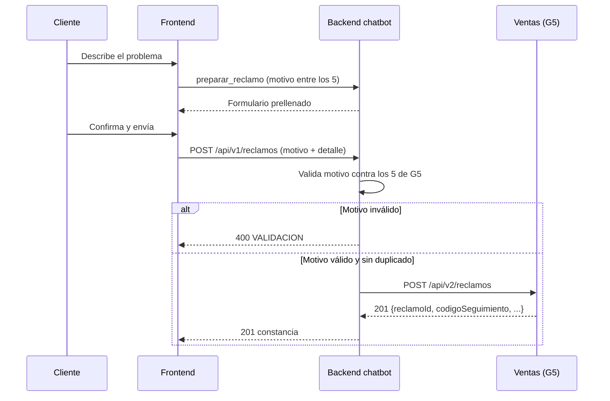
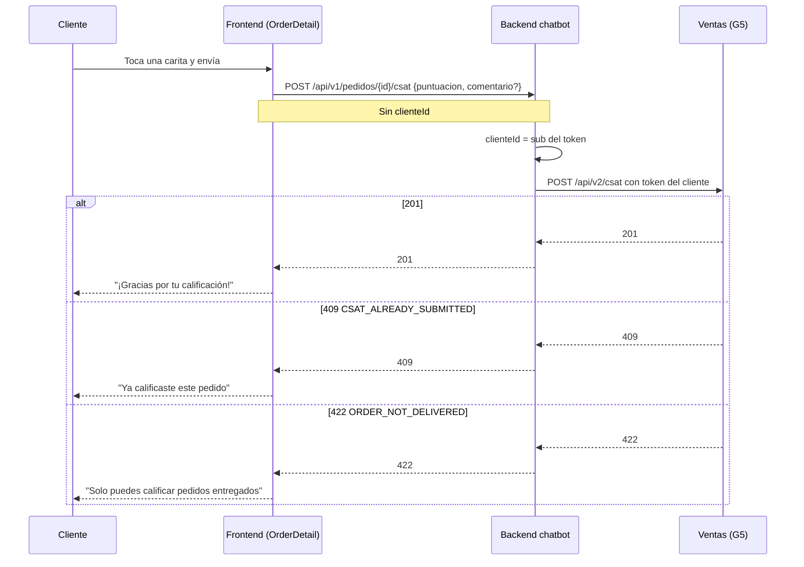

# Diseño: alinear postventa con el contrato real de G5

## Decisiones

1. **Una sola lista de motivos.** Los cinco valores de G5 son la única lista válida en el canal:
   el LLM, la herramienta `preparar_reclamo`, el formulario, el DTO del backend y la documentación
   usan exactamente esos literales. El canal no traduce alias ni completa valores: si el motivo no
   está en la lista, responde `400 VALIDACION` con `errores[{campo: "motivo", mensaje}]`.
2. **El motivo más cercano se explica en `detalle`.** Como G5 no tiene `OTRO`, el cliente elige el
   motivo que mejor describa el caso y escribe el detalle concreto en `detalle` (20 a 1000
   caracteres). El LLM puede proponer un motivo, pero el cliente lo confirma en el formulario.
3. **El CSAT es de Ventas y la UI no decide el dueño.** El frontend envía solo `{puntuacion,
   comentario?}` a `POST /api/v1/pedidos/{pedidoId}/csat`; el backend arma
   `{pedidoId, clienteId, canal: "CHATBOT", puntuacion, comentario?}` con `clienteId = sub` del token
   y reenvía el token del cliente a `POST /api/v2/csat`. Un `clienteId` enviado por el navegador no
   se acepta (el DTO tiene `extra="forbid"`).
4. **El bloque de CSAT vive en el detalle.** Se monta en `OrderDetailPage` (al pie del detalle) y no
   en `OrderHistoryPage` (lista). La lista solo muestra el pedido y el acceso a "Ver detalle".
5. **Los estados de CSAT son estados de interfaz, no errores.** `409 CSAT_ALREADY_SUBMITTED` se
   muestra como "Ya calificaste este pedido" y `422 ORDER_NOT_DELIVERED` como "Solo puedes calificar
   pedidos entregados"; ninguno se presenta como fallo de red. En ambos casos se refresca el detalle
   para reflejar el estado vigente.
6. **La evidencia se completó con la corrida real.** La tabla "Evidencia G5 2026-11" reúne los siete
   casos de la corrida del 2026-11-22 con hora UTC, endpoint, HTTP e id reales; el detalle está en
   `docs/contratos-integracion.md` §2.10. No se inventan resultados.

## Flujo de reclamo

## Flujo de CSAT

## Revisión de coherencia

> [!warning] Backend desalineado con la nueva lista
> `backend/src/application/dto/postventa_dto.py` (`CLAIM_REASON_TO_G5`) todavía acepta los ocho
> motivos de G3 y los traduce a los cinco de G5; además `CreateClaimRequest.motivo` no valida contra
> el enum. Con la spec nueva, ese comportamiento contradice el Requisito 1: un `PRODUCTO_DEFECTUOSO`
> o un `OTRO` debe responder `400 VALIDACION`, no registrarse con otro motivo. Se corrige en el PR
> de backend (`mod-postventa`).

> [!warning] Frontend desalineado con la nueva lista
> `frontend/src/domain/schemas/reclamo.schema.ts` y `ReclamoForm.tsx` ofrecen los ocho motivos de G3
> (incluido `OTRO`) y usan `PRODUCTO_DEFECTUOSO` como valor por defecto. Deben ofrecer solo los cinco
> de G5 y quitar el alias. Se corrige en el PR de frontend (`mod-postventa`).

> [!warning] CSAT duplicado en la lista de pedidos
> `frontend/src/adapters/inbound/pages/OrderHistoryPage.tsx` monta `DeliveryRating` dentro de la lista
> de pedidos entregados, además de `OrderDetailPage.tsx`. La spec nueva prohíbe el bloque en la lista:
> debe quedar solo al pie del detalle. Se corrige en el PR de frontend (`mod-orders` / `mod-postventa`).

> [!warning] Auditoría 2026-11 desactualizada para SPEC-19 y SPEC-24
> `docs/auditoria-specs-2026-11.md` marca SPEC-19 y SPEC-24 como "✅ Al día". Esa foto corresponde al
> código mergeado en #141/#109, que aún conserva los ocho motivos y el CSAT en la lista. Hasta que se
> mergeen los PR de backend y frontend, la auditoría no debe citarse como prueba de esta alineación;
> este cambio deja la spec como fuente de verdad y los pendientes en `tasks.md`.

> [!note] Sin contradicción con `modelo-datos.md`
> `claim_ref` no guarda `motivo`: solo `claim_id`, `code`, `order_id`, `customer_id`,
> `idempotency_key` y `created_at`. El motivo y el estado viven en Ventas, y la detección de
> duplicados consulta `GET /api/v1/reclamos` (proxy a `/me`). No hace falta migración ni columna
> nueva.

> [!note] Sin contradicción con ADR-0027
> El criterio de duplicado sigue siendo mismo `pedidoId` + mismo `motivo` en estado abierto, con
> `forzar: true` para insistir. El ADR no enumera motivos; solo cambia el conjunto de valores válidos
> que el backend debe comparar.

> [!note] Devoluciones no se tocan
> El enum de `solicitud-devolucion-cambio` (`TALLA_INCORRECTA`, `NO_ERA_LO_QUE_ESPERABA`,
> `PRODUCTO_DEFECTUOSO`, `PRODUCTO_EQUIVOCADO_ENVIADO`, `YA_NO_LO_QUIERO`, `OTRO`) es de F3 y es
> distinto del de reclamos. `PRODUCTO_DEFECTUOSO` sigue siendo válido **solo** para devoluciones; no
> se debe reutilizar en reclamos.

## Evidencia G5 2026-11

Corrida real del 2026-11-22 contra los servicios directos M1/M2 de G5 (el gateway devolvió challenge de Cloudflare y `429`). El detalle completo, las cuentas y las rutas BFF equivalentes están en `docs/contratos-integracion.md` §2.10.

| Caso | Operación | Endpoint ejecutado (G5) | HTTP | Hora UTC | id |
|---|---|---|---|---|---|
| EV-01 | Reclamo `INCUMPLIMIENTO_PLAZO_ENTREGA` | `POST https://g5-ventas-postventas-backend.onrender.com/api/v2/reclamos` | 201 | 2026-11-22T18:20:13Z | `REC-2026-0009` |
| EV-02 | Reclamo `PRODUCTO_DEFECTUOSO_O_INCORRECTO` | `POST https://g5-ventas-postventas-backend.onrender.com/api/v2/reclamos` | 201 | 2026-11-22T18:27:06Z | `REC-2026-0010` |
| EV-03 | Reclamo `COBRO_INDEBIDO_O_NO_RECONOCIDO` | `POST https://g5-ventas-postventas-backend.onrender.com/api/v2/reclamos` | 201 | 2026-11-22T18:27:06Z | `REC-2026-0011` |
| EV-04 | Reclamo `ATENCION_INADECUADA` | `POST https://g5-ventas-postventas-backend.onrender.com/api/v2/reclamos` | 201 | 2026-11-22T18:27:07Z | `REC-2026-0012` |
| EV-05 | Reclamo `INCUMPLIMIENTO_GARANTIA` | `POST https://g5-ventas-postventas-backend.onrender.com/api/v2/reclamos` | 201 | 2026-11-22T18:27:08Z | `REC-2026-0013` |
| EV-06 | CSAT de pedido `ENTREGADO`: primer envío y reintento | `POST https://g5-ventas-postventas-backend.onrender.com/api/v2/csat` | 201 / 409 `CSAT_ALREADY_SUBMITTED` | 2026-11-22T18:22:39Z (aprox.) / 18:22:41Z | `PED-2026-90201` |
| EV-07 | CSAT de pedido no entregado | `POST https://g5-ventas-postventas-backend.onrender.com/api/v2/csat` | 422 `ORDER_NOT_DELIVERED` | 2026-11-22T18:23:13Z | `PED-2026-90103` |

EV-01..EV-05 cubren los cinco motivos. 90101/90102 ya tenían CSAT y estaban fuera de plazo (entregados el 15/11 y 08/11), así que sus `409`/`400 PLAZO_VENCIDO` son datos de prueba de G5, no fallos del canal; 90201 se usó para el CSAT nuevo y la devolución `DEV-2026-0028`. Un `motivo: "OTRO"` directo a G5 devolvió `400 FORMATO_INVALIDO`; el BFF valida antes y expone `400 VALIDACION`.
